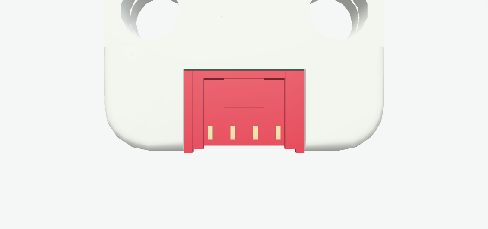
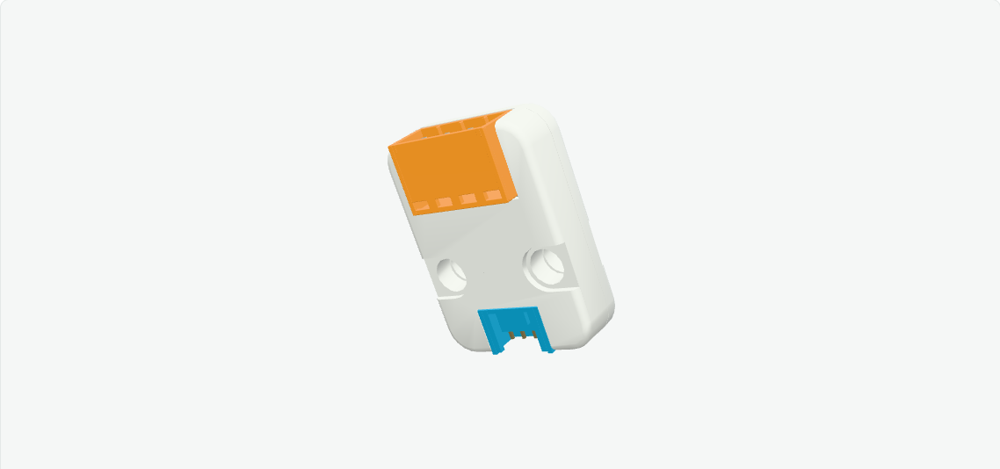

# m5stack-models.js

基于 Three.js 与 sticks3.js 建模方法的 M5Stack 毫米尺度交互模型库。目前包含 **14款主机、29款Unit，共43款模型**，全部保持 `modeled`，逐款精细外观验收继续进行。

模型提供实体按键压放、稳定开关、旋转和倾斜关节、Grove插头与四芯线缆，以及外部指定的灯光和帧缓冲。控件输出输入意图，固件、电气、协议和传感数据由下游系统提供。



本批重建 **Heart U029 和 RS485 U034 的开顶Grove插座**，补齐厚上唇、中央短锁定舌、四个短接触端和凹入底部支承。Heart依据自身官方开口图和壳体基准将工程接口中心Z从0调整为1.4mm，并为PCB增加开放边切口，清除接口通道堵塞。



公开构建已独立通过 `npm run check`、`npm run build` 和预览健康检查。实际浏览器45场景、59张独立原生截图通过，覆盖三种装配各七视图及接口近照、Heart红灯off/on/off、RS485四螺钉45°和复位，以及StickS3→HUB→Heart、StickS3→RS485接线、姿态和拆卸。59张公开截图与原始最终截图逐张RGB一致；原生console中的软件GL warning与favicon404保留，应用请求失败和pageerror为0。

[本批独立验证](artifacts/grove-open-top/public/review.json) · [来源审计](artifacts/grove-open-top/public/source-audit.json) · [下游Agent接入](docs/AGENT-INTEGRATION.md)

默认GroveModule会自动按新接口对齐；显式unitPose仍指装配原点，调用者应读取实际Port变换。原Port实例、名称、方向、hitSize、嵌套路径和全局插头/线缆保持兼容。

**贴纸继续等待原文件，不用照片裁图遮缺件。** 插座内腔、唇部、短针、底部支承和PCB缺口仍含照片推导；Heart旧PCB外边缘与源壳壁局部交叠、StackChan隐藏舵机交叠和生产装配基准仍待解决。有限数字采样和浏览器渲染不证明制造配合或实物功能。

## 本地运行

需要 Node.js 22.12+。

```sh
npm ci
npm run check
npm run build
./manage.sh start
```

打开 http://127.0.0.1:5188 。使用 `./manage.sh status|logs|stop|help` 管理预览，或运行 `npm run dev` 开发。检查覆盖实体压放、关节、全部当前 Unit 的线缆装配，以及真实主机接口上的线管表面采样；通过数见生成的 `artifacts/` 报告。浏览器视觉检查与实物配合分别记录，不以构建成功替代外观验收。

## 使用与分发

`src/core/` 保留 Device / Module / Component 接口，`src/devices/` 与 `src/units/` 按产品提供实现，`demo/` 展示浏览器交互，`catalog/products.json` 记录产品与进度。产品入口可按需导入；共享入口为 `src/index.js`。

[动态 API 与下游接入](docs/AGENT-INTEGRATION.md) · [视觉运动](docs/VISUAL-MOTION.md) · [Grove 线缆](docs/GROVE-CABLE.md) · [集成边界](docs/INTEGRATION.md) · [分发范围](docs/PUBLISHING.md)

贴纸等待用户提供原文件，当前停用照片裁切贴纸。分发源码包含几何/API专项与原创展示证据，排除官方本地照片、尺寸图/PDF、原始 STL、MCP 长篇原文和私有研究历史。目录参考图由浏览器加载官方原 URL，联网可用性取决于源站；来源 URL、Git blob 与 SHA-256 见 [source-manifest.json](source-manifest.json)。前期截图保存在 `artifacts/dynamics/` 和 `artifacts/refinement/`，属于各自历史快照，不能替代本轮证据。

## 许可

本项目自有新增代码使用 **MIT**，允许复用、修改和分发，完整条款见 [LICENSE](LICENSE)。第三方代码、CAD 衍生几何与依赖继续保留来源和许可，见 [THIRD_PARTY_NOTICES.md](THIRD_PARTY_NOTICES.md) 与 `licenses/`。项目许可不重新授权远程照片、第三方商标或其他未包含资产。

`package.json` 保留 `private: true` 以防意外发布到 npm；这不限制 GitHub 源码的 MIT 许可。私有研究仓库保留原名称与历史，公开分发使用独立目录和历史。
