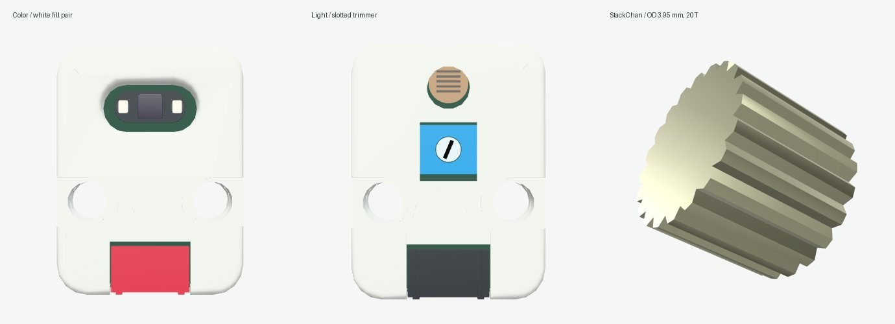

# m5stack-models.js

基于 Three.js 与 [sticks3.js](https://github.com/MarsTechHAN/sticks3.js) 建模方法的 M5Stack 毫米尺度交互模型库。当前包含 **14 款主机、28 款 Unit，共 42 款模型**；全部保持 `modeled`，逐款精细外观验收尚未完成。

模型提供实体按键按下／回弹、稳定开关、旋转／倾斜关节、Grove 插头与四芯线缆，以及由外部指定的灯光。屏幕接收外部帧缓冲，控件输出输入意图；固件、电气、协议和传感器行为由下游系统提供。



本轮补齐 Color U009 的两颗白补光实体封装与外驱亮度，Light U021 则有带真实工具槽和槽底的金属微调头，可由外部指定角度。StackChan 输出轴改为齿顶外径 Ø3.95 mm、轴长 3.2 mm 的 20 齿截面，保持原装配位置与关节轴。

[Color 白补光](artifacts/unit-functions/color-fill.gif) · [Light 微调头](artifacts/unit-functions/light-trim.gif) · [StickS3 → HUB → Light 连接](artifacts/unit-functions/stick-hub-light.png) · [输出轴细节](artifacts/unit-functions/shaft-output.png)

Color 的两颗灯实际共用 VCC；独立外观地址不表示独立 GPIO 或 RGB 器件，调用方负责反映供电状态。Light 的头部尺寸、槽深和演示角度范围包含照片推导，额定端挡、旋向和电气零位尚未确认；不模拟电阻、阈值或传感器逻辑。Relay U023 的灯光文案与原理图／照片存在冲突，保持待核准，不添加未确认灯具。

隐藏舵机仍为 `fit-unresolved`，当前有限采样仍检出隐藏实体交叠；全局头颈基准、右侧轴承座及部分隐藏结构继续待核准。本轮轴径修正不代表完整装配配合通过。有限几何采样和浏览器操作不代表连续碰撞、实物配合或硬件验证。**贴纸继续等待原文件，不用照片裁图遮缺件。**

本轮公开独立验证记录见 [review.json](artifacts/unit-functions/public/review.json)，包含当前源码指纹、三款七视图、12 项浏览器场景、回位像素比较、日志与真实命令回执。盖座、布线与主机 RGB 的历史证据保存在 `artifacts/seat-refinement/`，更早结果保留其各自快照。

## 本地运行

需要 Node.js 22.12+。

```sh
npm ci
npm run check
npm run build
./manage.sh start
```

打开 http://127.0.0.1:5188 。使用 `./manage.sh status|logs|stop|help` 管理预览，或运行 `npm run dev` 开发。检查覆盖实体压放、关节、全部当前 Unit 的线缆装配，以及真实主机接口上的线管表面采样；通过数见生成的 `artifacts/` 报告。浏览器视觉检查与实物配合分别记录，不以构建成功替代外观验收。

## 使用与分发

`src/core/` 保留 Device / Module / Component 接口，`src/devices/` 与 `src/units/` 按产品提供实现，`demo/` 展示浏览器交互，`catalog/products.json` 记录产品与进度。产品入口可按需导入；共享入口为 `src/index.js`。

[动态 API 与下游接入](docs/AGENT-INTEGRATION.md) · [视觉运动](docs/VISUAL-MOTION.md) · [Grove 线缆](docs/GROVE-CABLE.md) · [集成边界](docs/INTEGRATION.md) · [分发范围](docs/PUBLISHING.md)

贴纸等待用户提供原文件，当前停用照片裁切贴纸。分发源码包含几何/API专项与原创展示证据，排除官方本地照片、尺寸图/PDF、原始 STL、MCP 长篇原文和私有研究历史。目录参考图由浏览器加载官方原 URL，联网可用性取决于源站；来源 URL、Git blob 与 SHA-256 见 [source-manifest.json](source-manifest.json)。前期截图保存在 `artifacts/dynamics/` 和 `artifacts/refinement/`，属于各自历史快照，不能替代本轮证据。

## 许可

本项目自有新增代码使用 **MIT**，允许复用、修改和分发，完整条款见 [LICENSE](LICENSE)。第三方代码、CAD 衍生几何与依赖继续保留来源和许可，见 [THIRD_PARTY_NOTICES.md](THIRD_PARTY_NOTICES.md) 与 `licenses/`。项目许可不重新授权远程照片、第三方商标或其他未包含资产。

`package.json` 保留 `private: true` 以防意外发布到 npm；这不限制 GitHub 源码的 MIT 许可。私有研究仓库保留原名称与历史，公开分发使用独立目录和历史。
