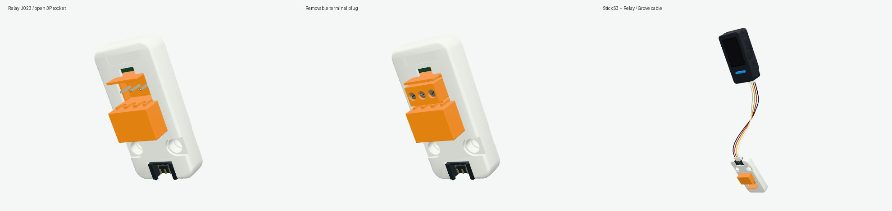

# m5stack-models.js

基于 Three.js 与 [sticks3.js](https://github.com/MarsTechHAN/sticks3.js) 建模方法的 M5Stack 毫米尺度交互模型库。当前包含 **14款主机、29款Unit，共43款模型**；全部保持`modeled`，逐款精细外观验收尚未完成。

模型提供实体按键压放、稳定开关、旋转／倾斜关节、Grove插头与四芯线缆，以及外部指定的灯光。屏幕接收外部帧缓冲，控件输出输入意图；固件、电气、协议与传感器行为由下游系统提供。



本轮补齐旧版 **Relay U023** 的外露继电器、真实开放3P座、COM／NO／NC触点和可拆螺钉插头。默认空座与`terminalPlug:true`两种配置都能查看；`TerminalPlug`附件挂接`terminal`，三颗螺钉沿`terminal/screw-1`…`screw-3`独立接收外驱转角。主机可通过真实Grove插头与四芯线连接Relay。基壳24×48×8 mm口径保留，官方完整外露深度14.6 mm，后螺钉另突出约0.055 mm。

同时修复Cardputer-ADV、CardputerZero、PaperMono、PaperColor、StamPLC的部分帽体共享材质悬停串色。核心Button接口与AtomS3R显示／帧缓冲引用保持；demo定格检查现包含瞬时按键、稳定滑块和零行程电容区。

当前公开构建已独立通过`npm run check`、`npm run build`与预览健康检查。新构建后，15配置／147项真实canvas鼠标检查全部通过：137项瞬时实体压放、4项滑块两档、6项电容输入。按配置累计，CoreS3两键也在DinBase配置中受检，不能称147个不重复物理控件。实体释放与滑块再次复位的RGB像素精确回位；电容只变输入状态，图像和机械行程保持不变。

Relay两种装配各七视图与19项实际浏览器场景通过，包括三螺钉可见45°旋转／精确复位、配置切换、Grove连接／姿态／断开。截图来自原生WebGL画布并隐藏工具栏，悬停状态通过真实鼠标移动归一。原始记录保留软件GL ReadPixels warning及隐式favicon 404；应用运行和模型请求错误为0。

[主机压放动效](artifacts/host-button-coverage/host-press.gif) · [当前独立验证](artifacts/host-button-coverage/public/review.json) · [来源审计](artifacts/host-button-coverage/public/source-audit.json)

Relay隐藏PCB、端子壁厚／接触深度与夹线结构含照片推导；螺钉不模拟螺纹升降、夹紧或电气通断，旧LED文案冲突保持。StackChan隐藏舵机交叠与全局装配基准仍未解决。有限数字采样和浏览器效果不证明制造配合或实物运行。

**贴纸继续等待原文件，不用照片裁图遮缺件。** Roller485、AtomS3R和其他前期证据保留各自历史快照；本轮原始来源见[source-manifest.json](source-manifest.json)。

## 本地运行

需要 Node.js 22.12+。

```sh
npm ci
npm run check
npm run build
./manage.sh start
```

打开 http://127.0.0.1:5188 。使用 `./manage.sh status|logs|stop|help` 管理预览，或运行 `npm run dev` 开发。检查覆盖实体压放、关节、全部当前 Unit 的线缆装配，以及真实主机接口上的线管表面采样；通过数见生成的 `artifacts/` 报告。浏览器视觉检查与实物配合分别记录，不以构建成功替代外观验收。

## 使用与分发

`src/core/` 保留 Device / Module / Component 接口，`src/devices/` 与 `src/units/` 按产品提供实现，`demo/` 展示浏览器交互，`catalog/products.json` 记录产品与进度。产品入口可按需导入；共享入口为 `src/index.js`。

[动态 API 与下游接入](docs/AGENT-INTEGRATION.md) · [视觉运动](docs/VISUAL-MOTION.md) · [Grove 线缆](docs/GROVE-CABLE.md) · [集成边界](docs/INTEGRATION.md) · [分发范围](docs/PUBLISHING.md)

贴纸等待用户提供原文件，当前停用照片裁切贴纸。分发源码包含几何/API专项与原创展示证据，排除官方本地照片、尺寸图/PDF、原始 STL、MCP 长篇原文和私有研究历史。目录参考图由浏览器加载官方原 URL，联网可用性取决于源站；来源 URL、Git blob 与 SHA-256 见 [source-manifest.json](source-manifest.json)。前期截图保存在 `artifacts/dynamics/` 和 `artifacts/refinement/`，属于各自历史快照，不能替代本轮证据。

## 许可

本项目自有新增代码使用 **MIT**，允许复用、修改和分发，完整条款见 [LICENSE](LICENSE)。第三方代码、CAD 衍生几何与依赖继续保留来源和许可，见 [THIRD_PARTY_NOTICES.md](THIRD_PARTY_NOTICES.md) 与 `licenses/`。项目许可不重新授权远程照片、第三方商标或其他未包含资产。

`package.json` 保留 `private: true` 以防意外发布到 npm；这不限制 GitHub 源码的 MIT 许可。私有研究仓库保留原名称与历史，公开分发使用独立目录和历史。
