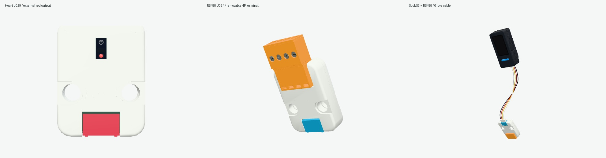

# m5stack-models.js

基于 Three.js 与 [sticks3.js](https://github.com/MarsTechHAN/sticks3.js) 建模方法的 M5Stack 毫米尺度交互模型库。当前包含 **14款主机、29款Unit，共43款模型**；全部保持`modeled`，逐款精细外观验收继续进行。

模型提供实体按键压放、稳定开关、旋转／倾斜关节、Grove插头与四芯线缆、外部指定的灯光与帧缓冲。控件输出输入意图，固件、电气、协议和传感数据由下游系统提供。



本轮细化 **Heart U029**：按MAX30100原厂封装补齐窗口内实体、两光窗及中央特征，保留原壳孔位。`red-led`提供默认关闭的固定可见红光，只接受外部明暗；远Grove的SENSOR圆窗保持被动，IR不绘成人眼可见光，不自动模拟心率闪烁。光晕固定于真实光窗平面，保留壳壁遮挡，避免斜视越过壳面。

同时补 **RS485 U034** 包装随附的可拆4P端子。默认空座与`terminalPlug:true`两配置可切换；产品入口导出`TerminalPlug`，四颗真实工具槽螺钉由`terminal/screw-1`…`screw-4`独立外驱。接触孔、线入口和夹笼保留实体深度；附件可单独拆下并保留Unit和Grove四芯线。

当前公开构建已独立通过`npm run check`、`npm run build`与预览健康检查。新build后39场景全部通过：Heart15项及RS48524项，覆盖三种装配的七视图、red off/on/off、四螺钉45°和复位、真实StickS3→HUB→Heart与StickS3→RS485接线／姿态／拆卸。关闭／复位RGB逐像素一致，Heart背面点灯无像素变化；51张配对公开原生截图与私有对应图RGB完全一致，另两张原生图直接验证HUB嵌套路径下的可见点亮差异。

[当前独立验证](artifacts/heart-rs485-detail/public/review.json) · [来源审计](artifacts/heart-rs485-detail/public/source-audit.json) · [下游Agent接入](docs/AGENT-INTEGRATION.md)

原始console保留软件GL ReadPixels warning和隐式favicon 404；应用运行与模型请求失败为0。Heart绝对Z座位、透镜剖面、材质和亮度，及RS485附件局部尺寸／夹笼仍含推导；有限数字采样和浏览器效果不证明制造配合或实物光学。螺钉不模拟螺纹升降、夹线、RS485/UART或供电，光窗不提供测量数据。

**贴纸继续等待原文件，不用照片裁图遮缺件。** StackChan隐藏舵机交叠与全局装配基准仍待解决。上一批147项主机控件与Relay19场景及其他历史证据保留各自快照；本轮来源见[source-manifest.json](source-manifest.json)。

## 本地运行

需要 Node.js 22.12+。

```sh
npm ci
npm run check
npm run build
./manage.sh start
```

打开 http://127.0.0.1:5188 。使用 `./manage.sh status|logs|stop|help` 管理预览，或运行 `npm run dev` 开发。检查覆盖实体压放、关节、全部当前 Unit 的线缆装配，以及真实主机接口上的线管表面采样；通过数见生成的 `artifacts/` 报告。浏览器视觉检查与实物配合分别记录，不以构建成功替代外观验收。

## 使用与分发

`src/core/` 保留 Device / Module / Component 接口，`src/devices/` 与 `src/units/` 按产品提供实现，`demo/` 展示浏览器交互，`catalog/products.json` 记录产品与进度。产品入口可按需导入；共享入口为 `src/index.js`。

[动态 API 与下游接入](docs/AGENT-INTEGRATION.md) · [视觉运动](docs/VISUAL-MOTION.md) · [Grove 线缆](docs/GROVE-CABLE.md) · [集成边界](docs/INTEGRATION.md) · [分发范围](docs/PUBLISHING.md)

贴纸等待用户提供原文件，当前停用照片裁切贴纸。分发源码包含几何/API专项与原创展示证据，排除官方本地照片、尺寸图/PDF、原始 STL、MCP 长篇原文和私有研究历史。目录参考图由浏览器加载官方原 URL，联网可用性取决于源站；来源 URL、Git blob 与 SHA-256 见 [source-manifest.json](source-manifest.json)。前期截图保存在 `artifacts/dynamics/` 和 `artifacts/refinement/`，属于各自历史快照，不能替代本轮证据。

## 许可

本项目自有新增代码使用 **MIT**，允许复用、修改和分发，完整条款见 [LICENSE](LICENSE)。第三方代码、CAD 衍生几何与依赖继续保留来源和许可，见 [THIRD_PARTY_NOTICES.md](THIRD_PARTY_NOTICES.md) 与 `licenses/`。项目许可不重新授权远程照片、第三方商标或其他未包含资产。

`package.json` 保留 `private: true` 以防意外发布到 npm；这不限制 GitHub 源码的 MIT 许可。私有研究仓库保留原名称与历史，公开分发使用独立目录和历史。
