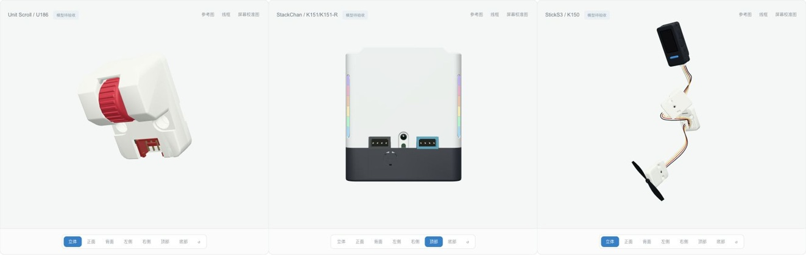
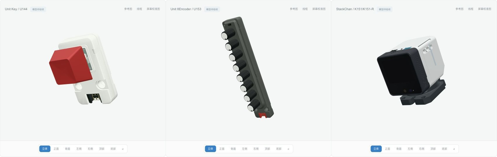

# m5stack-models.js

基于 Three.js 与 [sticks3.js](https://github.com/MarsTechHAN/sticks3.js) 建模方法的 M5Stack 毫米尺度交互模型库。当前包含 **14 款主机、28 款 Unit，共 42 款模型**。目录状态全部为 `modeled`，尚未逐款完成最终精细外观验收。

模型提供外观、实体按键行程、稳定开关、旋转/倾斜关节、Grove 插头线缆与外部灯光。屏幕接收外部帧缓冲，控件输出输入意图；固件、电气、协议、传感器数值及设备物理行为由下游系统提供。



本批新增 Unit Scroll U186：原 CAD 滚轮可旋转、按下和回弹，RGB 独立外驱；补齐开口 Grove 座和重建 PCB。0.25 mm 压程与隐藏支撑动作是外观近似。HUB 输出现在可继续接 Scroll、Fan 等 Unit，菜单保留完整端口路径，拆除子树时清理下游输入。Display 触点和帧缓冲纹理释放也已修复。

StackChan 顶部前／中／后三个电容触区和左右共十二路 RGB 均随头部关节，触摸不自动点灯。90° 抬头时中触区仍被现有盖座遮挡，整机可达性为 `partial`；隐藏舵机配合仍为 `fit-unresolved`。所有模型保持 `modeled`，贴纸继续等待原文件。

[Scroll 按压回位](artifacts/interaction-expansion/scroll-press.gif) · [真实 HUB 接线](artifacts/interaction-expansion/nested-hub.png) · [顶部 RGB](artifacts/interaction-expansion/stackchan-top-rgb.png)

公开版的本批独立验证记录见 [review.json](artifacts/interaction-expansion/public/review.json)；其中浏览器动作、日志、源码指纹和真实命令回执分别记录，有限采样不代表硬件或制造配合。

上一轮装卸生命周期快照：

上一轮修复接口装卸和输入生命周期：同实例原口挂载幂等、跨口转移不重复更新；拆卸前能在旧路径收到取消弹起。Viewer重复/跨实例挂载与销毁清理已回归，demo保留有效按键检查/LED选位，并释放过期异步加载结果。正常检查包含17类Port、13类Viewer和7类异步场景；浏览器证据见 `artifacts/lifecycle-refinement/`。

StackChan修正两端独立安装耳，保留真实舵机尺寸与关节轴。隐藏机械配合仍为 `fit-unresolved`，严格诊断以2退出；盖板/电机/Adapter候选没有进入运行模型。详情见 [数值诊断](artifacts/stackchan-servo-fit-check.json) 和 [视觉运动边界](docs/VISUAL-MOTION.md)。

[当前姿态与Grove接线](artifacts/lifecycle-refinement/stackchan-env-posed.png) · [连接后选位保持](artifacts/lifecycle-refinement/8encoder-selection.png) · [拆卸取消](artifacts/lifecycle-refinement/cores3-key-detached.png)

前一批新增与机械细化快照：



[主机与新 Unit 接线](artifacts/motion-refinement/connections.jpg) · [Key 按压回位](artifacts/motion-refinement/key-press.gif) · [StackChan 组合姿态](artifacts/motion-refinement/stackchan-motion.gif)

新增 Unit Key U144 和 Unit 8Encoder U153，补齐空心键帽、盲轴孔、PCB、Grove 与独立 RGB。StackChan 校正前侧 Power 板、下端 Adapter、七线跨关节线束和真实底座 USB 腔，后部保留官方开放机构。灯光、角度和转速均由外部指定。贴纸等待原文件，隐藏件与未获机械图确认的行程明确为外观估计。

## 本地运行

需要 Node.js 22.12+。

```sh
npm ci
npm run check
npm run build
./manage.sh start
```

打开 http://127.0.0.1:5188 。使用 `./manage.sh status|logs|stop|help` 管理预览，或运行 `npm run dev` 开发。检查覆盖实体压放、关节、全部当前 Unit 的线缆装配，以及真实主机接口上的线管表面采样；通过数见生成的 `artifacts/` 报告。浏览器视觉检查与实物配合分别记录，不以构建成功替代外观验收。

## 使用与分发

`src/core/` 保留 Device / Module / Component 接口，`src/devices/` 与 `src/units/` 按产品提供实现，`demo/` 展示浏览器交互，`catalog/products.json` 记录产品与进度。产品入口可按需导入；共享入口为 `src/index.js`。

[动态 API 与下游接入](docs/AGENT-INTEGRATION.md) · [视觉运动](docs/VISUAL-MOTION.md) · [Grove 线缆](docs/GROVE-CABLE.md) · [集成边界](docs/INTEGRATION.md) · [分发范围](docs/PUBLISHING.md)

贴纸等待用户提供原文件，当前停用照片裁切贴纸。分发源码包含几何/API专项与原创展示证据，排除官方本地照片、尺寸图/PDF、原始 STL、MCP 长篇原文和私有研究历史。目录参考图由浏览器加载官方原 URL，联网可用性取决于源站；来源 URL、Git blob 与 SHA-256 见 [source-manifest.json](source-manifest.json)。前期截图保存在 `artifacts/dynamics/` 和 `artifacts/refinement/`，属于各自历史快照，不能替代本轮证据。

## 许可

本项目自有新增代码使用 **MIT**，允许复用、修改和分发，完整条款见 [LICENSE](LICENSE)。第三方代码、CAD 衍生几何与依赖继续保留来源和许可，见 [THIRD_PARTY_NOTICES.md](THIRD_PARTY_NOTICES.md) 与 `licenses/`。项目许可不重新授权远程照片、第三方商标或其他未包含资产。

`package.json` 保留 `private: true` 以防意外发布到 npm；这不限制 GitHub 源码的 MIT 许可。私有研究仓库保留原名称与历史，公开分发使用独立目录和历史。
