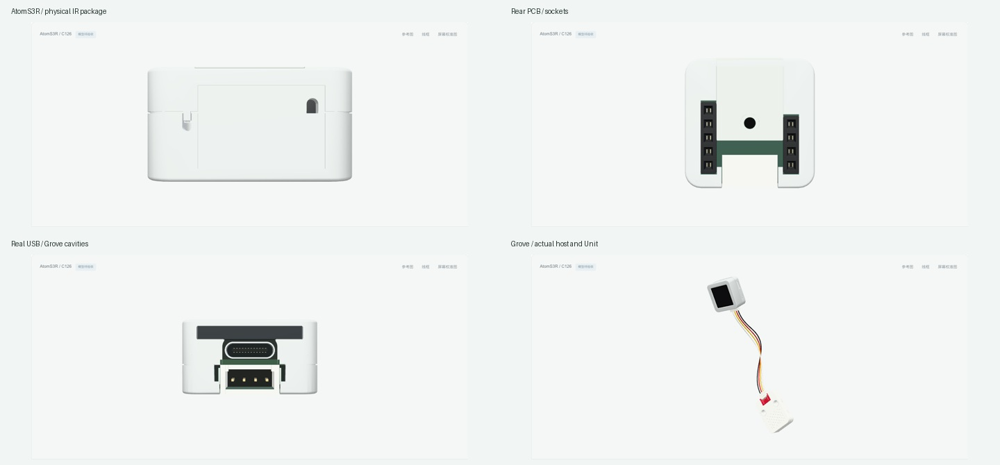

# m5stack-models.js

基于 Three.js 与 [sticks3.js](https://github.com/MarsTechHAN/sticks3.js) 建模方法的 M5Stack 毫米尺度交互模型库。当前包含 **14 款主机、28 款 Unit，共 42 款模型**；全部保持 `modeled`，逐款精细外观验收尚未完成。

模型提供实体按键按下／回弹、稳定开关、旋转／倾斜关节、Grove 插头与四芯线缆，以及由外部指定的灯光。屏幕接收外部帧缓冲，控件输出输入意图；固件、电气、协议和传感器行为由下游系统提供。



本轮补上 AtomS3R 顶部 IR 开口后的真实光学封装、端子与局部 PCB 支承，保留官方壳体与开孔。此前此处可穿过整机看到对侧内壁；现在原窗口首先命中凹入的暗色光学实体。推导封装经原壳三角面避让复核，双键、LCD 与 Grove 接口保持原有 API。

[顶窗近照](artifacts/atoms3r-ir/atoms3r-top.png) · [实体按键压放](artifacts/atoms3r-ir/button-press.gif) · [当前独立验证](artifacts/atoms3r-ir/public/review.json)

IR 封装、引脚、支承尺寸和安装深度包含照片推导。模型不增加可见红灯，也不模拟 IR 信号。内部绿色下载灯的外部光学位置和另一顶边窄槽用途仍待确认，保留原槽；**贴纸继续等待原文件，不用照片裁图遮缺件。**

当前私有和公开构建均通过，公开浏览器覆盖七视图、实际 IR 顶窗近照、两键控件与真实 canvas 按下/释放、外部 LCD 帧缓冲、Grove 接线和完整输入路径。两键释放后 RGB 像素精确回位；帧缓冲比较限定在 LCD 区域。源码、命令、截图、动作和来源审计见上述独立验证记录。光学/电气/制造配合与有限数字采样分别判断，产品阶段仍为 `modeled`。

StackChan 的隐藏实体交叠和全局装配基准仍未解决。本轮不改变其壳、轴或安装位置。前一轮 Color/Light 可见功能与轴形证据保存在 `artifacts/unit-functions/`，更早结果保留其各自快照。

## 本地运行

需要 Node.js 22.12+。

```sh
npm ci
npm run check
npm run build
./manage.sh start
```

打开 http://127.0.0.1:5188 。使用 `./manage.sh status|logs|stop|help` 管理预览，或运行 `npm run dev` 开发。检查覆盖实体压放、关节、全部当前 Unit 的线缆装配，以及真实主机接口上的线管表面采样；通过数见生成的 `artifacts/` 报告。浏览器视觉检查与实物配合分别记录，不以构建成功替代外观验收。

## 使用与分发

`src/core/` 保留 Device / Module / Component 接口，`src/devices/` 与 `src/units/` 按产品提供实现，`demo/` 展示浏览器交互，`catalog/products.json` 记录产品与进度。产品入口可按需导入；共享入口为 `src/index.js`。

[动态 API 与下游接入](docs/AGENT-INTEGRATION.md) · [视觉运动](docs/VISUAL-MOTION.md) · [Grove 线缆](docs/GROVE-CABLE.md) · [集成边界](docs/INTEGRATION.md) · [分发范围](docs/PUBLISHING.md)

贴纸等待用户提供原文件，当前停用照片裁切贴纸。分发源码包含几何/API专项与原创展示证据，排除官方本地照片、尺寸图/PDF、原始 STL、MCP 长篇原文和私有研究历史。目录参考图由浏览器加载官方原 URL，联网可用性取决于源站；来源 URL、Git blob 与 SHA-256 见 [source-manifest.json](source-manifest.json)。前期截图保存在 `artifacts/dynamics/` 和 `artifacts/refinement/`，属于各自历史快照，不能替代本轮证据。

## 许可

本项目自有新增代码使用 **MIT**，允许复用、修改和分发，完整条款见 [LICENSE](LICENSE)。第三方代码、CAD 衍生几何与依赖继续保留来源和许可，见 [THIRD_PARTY_NOTICES.md](THIRD_PARTY_NOTICES.md) 与 `licenses/`。项目许可不重新授权远程照片、第三方商标或其他未包含资产。

`package.json` 保留 `private: true` 以防意外发布到 npm；这不限制 GitHub 源码的 MIT 许可。私有研究仓库保留原名称与历史，公开分发使用独立目录和历史。
