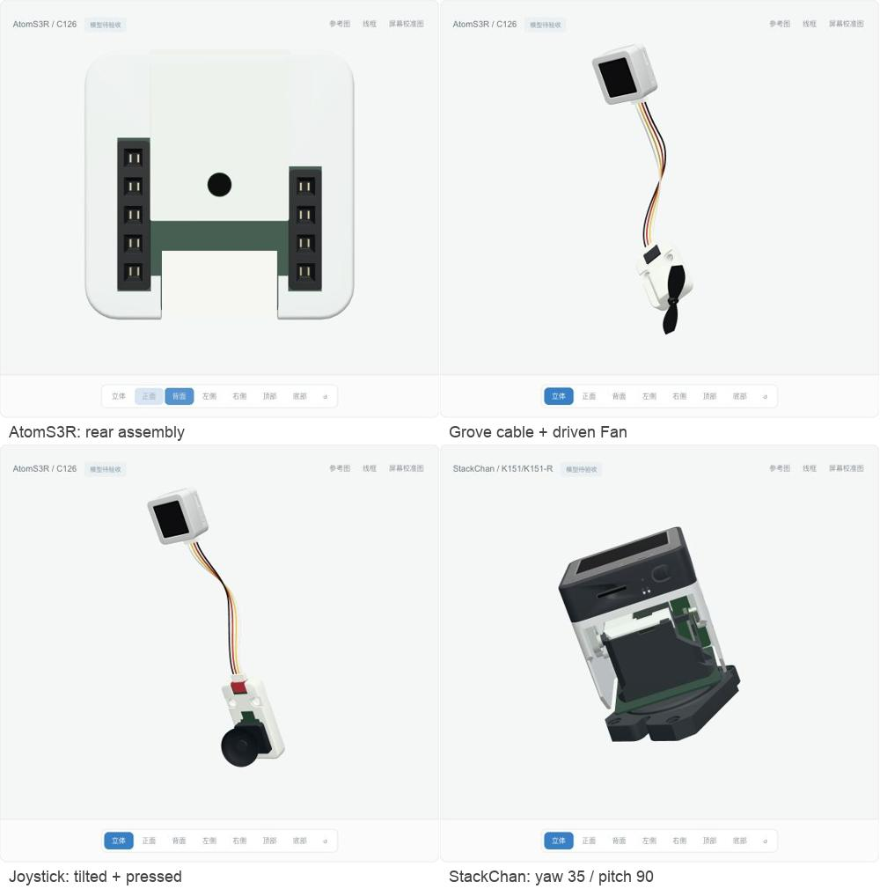
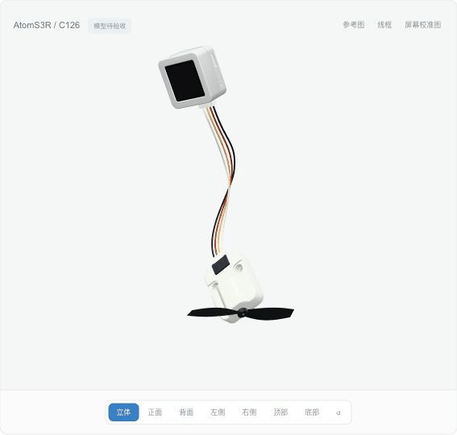
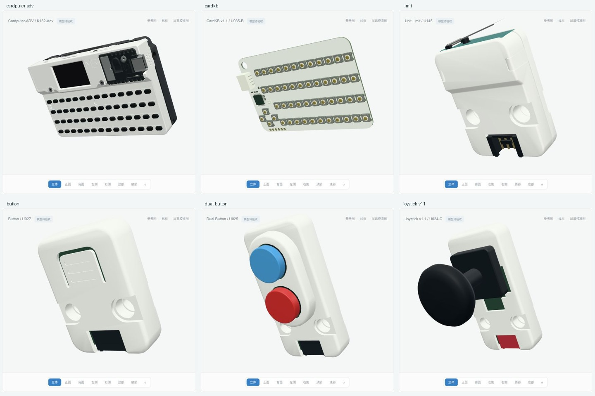

# m5stack-models.js

基于 Three.js 与 sticks3.js 建模方法的 M5Stack 毫米尺度交互模型库。当前包含 **14 款主机、25 款 Unit，共 39 款模型**。目录状态全部为 `modeled`，尚未逐款完成全部视角与官方参考图的视觉验收。

模型提供外观、实体按键行程、稳定开关、旋转/倾斜关节和 Grove 插头线缆的视觉运动。屏幕接收外部帧缓冲，控件输出输入意图；固件、电气、协议、传感器数值及设备物理行为由下游系统提供。





[主机外壳展示](artifacts/dynamics/controllers-overview.jpg) · [Unit 连接展示](artifacts/dynamics/connections-overview.jpg)

本轮新增 Limit U145 和 CardKB v1.1 U035-B，并精修 Cardputer-ADV 接口/接缝、Button 原壳柔性按压、Dual Button 实体彩帽与 Joystick 表面。新增代码采用用户确认的 MIT。



[两款新 Unit 接线](artifacts/refinement/connections.jpg) · [Limit 实际按压回位](artifacts/refinement/limit-press.gif)

## 本地运行

需要 Node.js 22.12+。

```sh
npm ci
npm run check
node scripts/check-grove-cable.mjs
node scripts/check-visual-motion.mjs
npm run build
./manage.sh start
```

打开 http://127.0.0.1:5188 。使用 `./manage.sh status|logs|stop|help` 管理预览，或运行 `npm run dev` 开发。

## 使用与分发

`src/core/` 保留 Device / Module / Component 接口，`src/devices/` 与 `src/units/` 按产品提供实现，`demo/` 展示浏览器交互，`catalog/products.json` 记录产品与进度。产品入口可按需导入；共享入口为 `src/index.js`。

[动态 API 与下游接入](docs/AGENT-INTEGRATION.md) · [视觉运动](docs/VISUAL-MOTION.md) · [Grove 线缆](docs/GROVE-CABLE.md) · [集成边界](docs/INTEGRATION.md) · [分发范围](docs/PUBLISHING.md)

贴纸等待用户提供原文件，当前停用照片裁切贴纸。分发源码包含完整几何/API专项与原创展示证据，排除官方本地照片、尺寸图/PDF、原始 STL、MCP 长篇原文和私有研究历史。目录参考图由浏览器直接加载官方原 URL，联网可用性取决于源站；来源 URL、Git blob 与 SHA-256 见 [source-manifest.json](source-manifest.json)。

## 许可

本项目自有新增代码使用 **MIT**，允许复用、修改和分发，完整条款见 [LICENSE](LICENSE)。第三方代码、CAD 衍生几何与依赖继续保留其来源和许可，见 [THIRD_PARTY_NOTICES.md](THIRD_PARTY_NOTICES.md) 与 `licenses/`。项目许可不重新授权远程照片、第三方商标或其他未包含资产。

`package.json` 保留 `private: true` 以防意外发布到 npm；这不限制 GitHub 源码的 MIT 许可。私有研究仓库保留原名称与历史，公开分发使用独立目录和历史。
