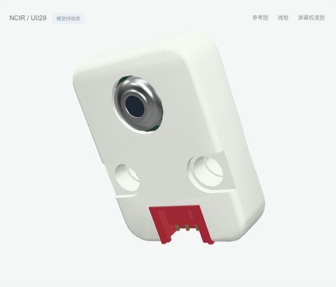
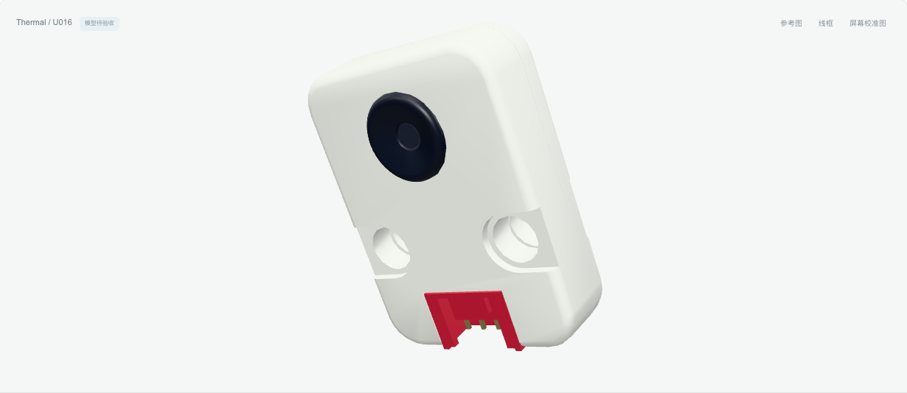
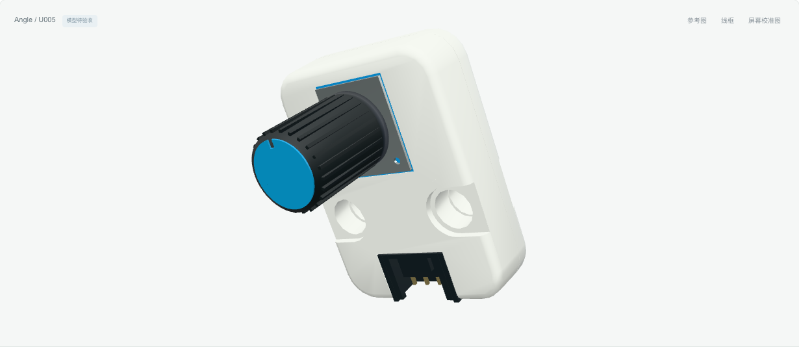
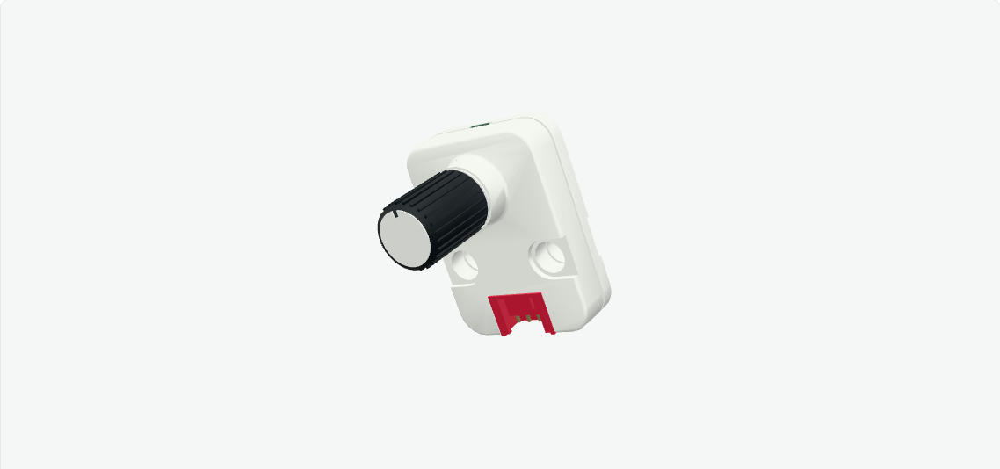
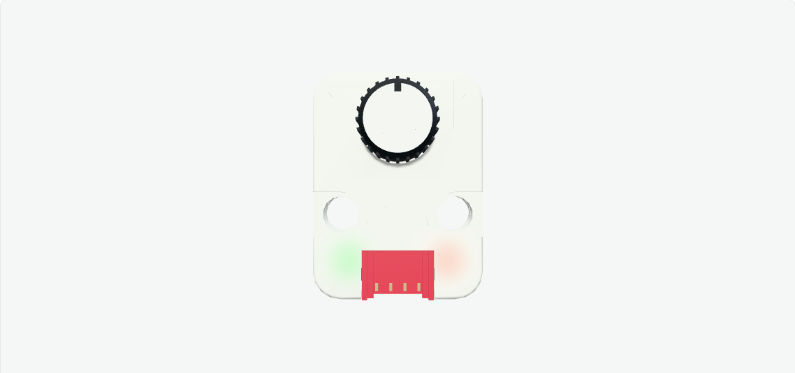
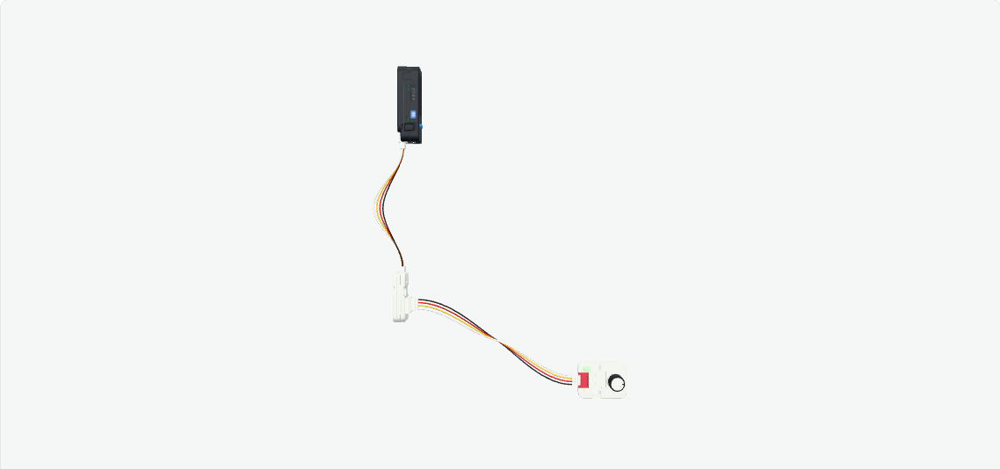

# README 检查点归档（2026-10-27）

以下保留整理前 README 的完整正文，仅按本文件位于 `docs/history/` 的位置调整仓库内相对链接。产品数量、提交、测试和待同步描述均属于对应历史检查点，不表示当前状态。当前用途、运行方式和目录状态见[项目 README](../../README.md)。

---

# m5stack-models.js

## 最新本地增量：Atom Lite / 原 Atom Matrix / AtomS3 Lite（第53批三主机）

当前本地201款（17主机、184Unit），全部 `modeled`、`verified` 为0。本批新增3款controller主机和6张普通PNG；既有pending11Unit/15PNG保留。Git187 / `296128b` 同步基线保持，未再次提交推送。实际API与边界见[本批指南](../ATOMLITE-ATOMMATRIX-ATOMS3LITE-CONTROLLERS.md)。

atom-lite C008：2键[button,reset]、灯1[rgb]、4接口[grove,usb,ext-5p,ext-4p]、PNG2；atom-matrix C008-B：2键[button,reset]、灯25[led0…led24（25个独立地址）]、4接口[grove,usb,ext-5p,ext-4p]、PNG2；atoms3-lite C124：2键[button,reset]、灯1[rgb]、4接口[usb,grove,ext-5p,ext-4p]、PNG2。三款无主机Display/传感器模拟；原壳、真实接口、PCB/接点/承托和按键动作保留，隐藏BOM、行程与配合推导另记。

本批双仓实际专项、导出/alias/lazy loader及双build通过，记录见[公开本批进度](../../artifacts/atomlite-atommatrix-atoms3lite-expansion/progress.json)。贴纸与模型同步；私表、原始链接/文件名、矢量和映射留在分发树外。未逐面浏览器/GPU、制造或实物验收；既有延期边界保留。

## 前批检查点：LoRaWAN AS923 / EU868

该批保存时本地198款（14主机、184Unit），全部 `modeled`、`verified` 为0。本批两款与4张普通PNG同步新增。GitHub `main`的187款已同步于 `296128b`，见[187款同步记录](../GIT-SYNC-187-2026-10-27.md)；随后批49/50/51/52共11款/15PNG仍为本地增量，未再次提交推送。实际结构/API见[本批指南](../LORAWAN-AS923-EU868-UNITS.md)，54批范围见[增量索引](../LOCAL-EXPANSION.md)。

AS923/EU868分别保留自身MIT native前后两半的全部源面与preview逐面对映；24×64×8壳和71.4含SMA包络分记。AS923自身195mm/2.3dBi天线与EU868自身195mm/2.8dBi天线独立记录，本款前后标签分别重绘，不借US915/CN470标签。实际本体/附件API和PNG：lorawan-as923 控件0[无]、XY摇杆[无]、灯0[无]、显示0[无]、本体关节[无]、附件导出[Antenna]、端口[grove,antenna]、PNG2；lorawan-eu868 控件0[无]、XY摇杆[无]、灯0[无]、显示0[无]、本体关节[无]、附件导出[Antenna]、端口[grove,antenna]、PNG2；附件关节详见冻结API与专项夹具。隐藏承托/接点/轴/行程/天线内部及配合均明记推导；RF/UART/AT/电气/固件由外部实现。

本批同步印刷：Unit LoRaWAN-AS923 2张参考重绘；Unit LoRaWAN-EU868 2张参考重绘。本款清楚PCB/标签准确重绘普通PNG，真实基材/PCB与全部物理及运动在去墨后保留；不裁照片、不借错款、不猜微字/个体码、不用图遮缺件。本批0批准本体原稿；EU868严格同名8条为5包装/3错Module，既有3下载全拒用，新增下载0。私表/URL/原名/映射/矢量/原图/生成器/中间件不分发。新代码MIT，自身native保原MIT，源图文/商标各保其权利。

两入口/实际配置去墨、实际附件装卸/递归关节部分动作、真实四芯线束和层级寻址、StickS3→HUB两分支、变父/peer/noecho/framebuffer/释放、6导出/双build和在线PNG已保存[本批进度](../../artifacts/lorawan-as923-eu868-expansion/progress.json)。既有Unit/core/Scroll/demo/rotary-panel当前基线保持。未逐面浏览器/GPU、历史全量或实物验收；旧50PNG、私Scroll、StackChan量产fit-unresolved、Puzzle Bridge、Catch及既有延期保持，整体goal active。


## 前批检查点：CardKB original / PoE CAM-W original / LoRaWAN US915

该批保存时本地196款（14主机、182Unit），全部 `modeled`、`verified` 为0。本批三款与4张普通PNG同步新增。GitHub `main`的187款已同步于 `296128b`，见[187款同步记录](../GIT-SYNC-187-2026-10-27.md)；随后批49/50/51共9款/11PNG仍为本地增量，未再次提交推送。实际结构/API见[本批指南](../CARDKBORIGINAL-POECAMORIGINAL-LORAWANUS915-UNITS.md)，53批范围见[增量索引](../LOCAL-EXPANSION.md)。

原CardKB U035按本款MEGA328P白板/50真实帽/方开关保持和单RGB重建，88×54×5表与84×54图注冲突仍以暂定外观依据分列；原PoE CAM-W U121-B按自身64×24×18壳、OV2640光学/PCB/PoE/接口/双键和蓝绿黄灯重建，不借v1.1或造未证外RGB。US915保留自身MIT native两半全部源面及重复preview配对，分记64mm壳与71.4含SMA和自身195mm天线；不借CN470。实际API/PNG：cardkb-original 控件50[key-esc,key-1,key-2,key-3,key-4,key-5,key-6,key-7,key-8,key-9,key-0,key-backspace,key-tab,key-q,key-w,key-e,key-r,key-t,key-y,key-u,key-i,key-o,key-p,key-fn,key-shift,key-a,key-s,key-d,key-f,key-g,key-h,key-j,key-k,key-l,key-enter,key-sym,key-z,key-x,key-c,key-v,key-b,key-n,key-m,key-comma,key-period,key-space,key-up,key-left,key-right,key-down]、XY摇杆[无]、灯1[rgb]、显示0[无]、本体关节[无]、附件导出[无]、端口[grove]、PNG1；poe-cam-w 控件2[user,reset]、XY摇杆[无]、灯3[g0,link,activity]、显示0[无]、本体关节[无]、附件导出[无]、端口[grove,ethernet,download-en,download-uart]、PNG1；lorawan-us915 控件0[无]、XY摇杆[无]、灯0[无]、显示0[无]、本体关节[无]、附件导出[Antenna]、端口[grove,antenna]、PNG2。隐藏安装/接点/行程/光学与配合均明记推导；通信/图像/AI/电气/固件由外部实现。

本批同步印刷：Unit CardKB (original MEGA328P U035) 1张参考重绘；Unit PoE CAM-W (original OV2640 U121-B) 1张参考重绘；Unit LoRaWAN-US915 2张参考重绘。本款清楚PCB/标签准确重绘普通PNG，真实基材/PCB与全部物理及运动在去墨后保留；不裁照片、不借错款、不猜微字/个体码、不用图遮缺件。私表未取得本批精确本体原稿；私表/URL/原名/映射/矢量/原图/生成器/中间件不分发。新代码MIT，自身native保原MIT，源图文/商标各保其权利。

两入口/实际配置去墨、真实帽按放/取消与外驱灯、真实四芯线束和层级寻址、StickS3→HUB三分支、变父/peer/noecho/framebuffer/释放、7导出/双build和在线PNG已保存[本批进度](../../artifacts/cardkboriginal-poecamoriginal-lorawanus915-expansion/progress.json)。既有Unit/core/Scroll/demo/rotary-panel当前基线保持。未逐面浏览器/GPU、历史全量或实物验收；旧50PNG、私Scroll、StackChan量产fit-unresolved、Puzzle Bridge、Catch及既有延期保持，整体goal active。


## 前批检查点：M5Camera / ESP32CAM / RGB LED Strip 50cm

该批保存时本地193款（14主机、179Unit），全部 `modeled`、`verified` 为0。本批新增原M5Camera U017、裸板ESP32CAM U007、RGB LED Strip 50cm A093及2张本款普通PNG。GitHub `main`的187款已同步于 `296128b`，见[187款同步记录](../GIT-SYNC-187-2026-10-27.md)；随后批49/50共6款/7PNG仍为本地增量，未再次提交推送。实际结构/API见[本批指南](../M5CAMERA-ESP32CAM-RGBSTRIP50-UNITS.md)，52批范围见[增量索引](../LOCAL-EXPANSION.md)。

三款均按自身官方资料/多视图程序重建，无本款native，不借相近型号。M5Camera含耳名义40×48×11，黑壳后标有真实基材及自身PCB/WROVER背衬，实际RESET与被动OV2640光学；ESP32CAM按细长双面裸板/光学FPC/真实USB-C/Grove与可见侧帽，旧20.5×46.5×11.5作为暂定外观参考，当前54×54×26.6与接口/引脚版本冲突另存。A093为500mm30颗5050、真实柔性包覆/背胶、黑3P/三导线和随附Grove插头转接，不拉伸A035或造4P本体接收座。实际API/PNG：m5camera 控件1[reset]、XY摇杆[无]、灯0[无]、显示0[无]、关节[无]、端口[grove,usb]、PNG1；esp32cam 控件1[key]、XY摇杆[无]、灯0[无]、显示0[无]、关节[无]、端口[grove,usb]、PNG0；rgb-led-strip-50cm 控件0[无]、XY摇杆[无]、灯30[pixel-0,pixel-1,pixel-2,pixel-3,pixel-4,pixel-5,pixel-6,pixel-7,pixel-8,pixel-9,pixel-10,pixel-11,pixel-12,pixel-13,pixel-14,pixel-15,pixel-16,pixel-17,pixel-18,pixel-19,pixel-20,pixel-21,pixel-22,pixel-23,pixel-24,pixel-25,pixel-26,pixel-27,pixel-28,pixel-29]、显示0[无]、关节[无]、端口[input,output]、PNG1。隐藏装配、厚度、接点、行程和弯曲限制明确推导；通信/图像/AI/电气/固件由外部实现。

本批同步印刷：M5Camera (original U017) 1张参考重绘；ESP32CAM (original U007)无PNG，保真实无色原生压纹；Unit RGB LED Strip 0.5m / 30LED 1张参考重绘。仅从本款清楚后标/PCB字样准确代码重绘普通PNG，去墨保基材/PCB/壳/胶层和全部物理；不裁照片、不借错款、不猜微字/个体码/未见3M背印、不用图遮缺件。私表匹配未取得这三款精确本体原稿，原资料/URL/原名/映射/矢量/生成器/中间件不分发。新代码MIT，源图文和商标各保其权利。

两入口/实际配置去墨、实际帽按放/取消与外驱逐灯/弯曲、真实端头/线束接合与层级地址、StickS3→HUB三分支、变父/peer/无echo、framebuffer/资源释放、7导出/双build和在线PNG已保存[本批进度](../../artifacts/m5camera-esp32cam-rgbstrip50-expansion/progress.json)。未逐面浏览器/GPU、历史全量或实物验收；旧50PNG、私Scroll、StackChan量产fit-unresolved、Puzzle Bridge、Catch及既有延期保持，整体goal active。


## 前批检查点：PaHub v2.0 / PbHub / TimerCamera

该批保存时本地190款（14主机、176Unit），全部 `modeled`、`verified` 为0。本批新增PaHub v2.0 U040-B、原PbHub U041、裸板TimerCamera U082及5张本款普通PNG。GitHub `main`的187款已同步于 `296128b`，见[187款同步记录](../GIT-SYNC-187-2026-10-27.md)；随后批49共3款/5PNG仍为本地增量，未再次提交推送。实际结构/API见[本批指南](../PAHUBV20-PBHUB-TIMERCAMERA-UNITS.md)，51批范围见[增量索引](../LOCAL-EXPANSION.md)。

PaHub使用本款原生闭合后壳/开窗前框，排重复整装预览，原生8mm壳与10.8mm整机口包络分记；真实红PCB/可见芯片腿/七4P座/承托补齐，大开窗按实物保留。原PbHub按自身多视图参数化黑PCB/QFP32/晶体/七座与完整壳，当前10.8与旧12厚、MEGA/STM型号及后膜地址版本冲突保留。TimerCamera按原款双面裸板/光学FPC/USB-C/Grove/空电池座重建，只有真实双帽动作、固定蓝灯外驱和被动camera frame，不添F/X壳或电池。实际API/PNG：pahub-v20 控件0[无]、XY摇杆[无]、灯0[无]、显示0[无]、关节[无]、端口[grove,grove-0,grove-1,grove-2,grove-3,grove-4,grove-5]、PNG2；pbhub 控件0[无]、XY摇杆[无]、灯0[无]、显示0[无]、关节[无]、端口[grove,grove-0,grove-1,grove-2,grove-3,grove-4,grove-5]、PNG2；timercamera 控件2[reset,power]、XY摇杆[无]、灯1[status]、显示0[无]、关节[无]、端口[grove,usb]、PNG1。隐藏装配/行程/接点和配合推导另记，无完整BOM/制造或实物验收声明，无内部通信/采样/电气/固件。

本批印刷同步：Unit PaHub v2.0 2张参考重绘；Unit PbHub 2张参考重绘；TimerCamera (bare board) 1张参考重绘。本款清楚后膜/PCB数字与板丝印代码准确重绘普通PNG，真实膜/PCB/native压纹去墨保留；不裁照片/借错款/猜微字或个体码，不以图遮缺件。TimerCamera两项私候选是包装，已拒绝且0原稿下载。私表/URL/原名/映射/矢量/原始资料/生成器/中间件留分发树外。新代码MIT；native保上游MIT/Copyright声明，官方照片和商标各保其权利。

两入口/实际配置及partial帽动作去墨、两个Hub各六输出真实下游四芯/层级寻址、StickS3→HUB三分支、变父/peer/外驱无echo、framebuffer/资源释放、6导出/双build及在线PNG已保存[本批进度](../../artifacts/pahubv20-pbhub-timercamera-expansion/progress.json)。未逐面浏览器/GPU、历史全量或硬件验收；旧50PNG、私Scroll、StackChan量产fit-unresolved、Puzzle Bridge、Catch及既有延期保持，整体goal active。


## 前批检查点：ENV II / Joystick / GPS

该批保存时本地187款（14主机、173Unit），全部 `modeled`、`verified` 为0。本批新增原ENV-II U001-B、原Joystick U024、原GPS U032及4张本款普通PNG。本次Git同步收录全部187款及批41–48新增的24款/40PNG，见[187款同步记录](../GIT-SYNC-187-2026-10-27.md)。历史检查点中的Git状态保留其保存时点；当前提交与远端状态以Git日志及GitHub main为准。实际结构/API见[本批指南](../ENVII-JOYSTICK-GPS-UNITS.md)，50批范围见[增量索引](../LOCAL-EXPANSION.md)。

三款按自身官方尺寸/多视图参数化，无本款CAD，不借后代。ENV-II保SHT30/BMP280、40真槽/承托，当前24×32×8与旧24.2×32.2×8.1分记；Joystick保原MEGA328P、帽/轴/杯/金属载体及实际XY倾斜/Z瞬时按放与回弹，名义24×48×32和帽体完整包络分记，J3未实装不造座；GPS保24×48×8自身维图/2孔/蓝Grove/两膜，小缺口用途未证不造灯。实际API/PNG：env-ii 控件0[无]、XY摇杆[无]、灯0[无]、显示0[无]、关节[无]、端口[grove]、PNG1；joystick 控件1[press]、XY摇杆[stick]、灯0[无]、显示0[无]、关节[无]、端口[grove]、PNG1；gps 控件0[无]、XY摇杆[无]、灯0[无]、显示0[无]、关节[无]、端口[grove]、PNG2。隐藏内部/配合、摇杆pivot/travel/limits明确推导，不称完整BOM或制造实测；读数、ADC、通信、电气和固件由外部实现。

本批印刷同步：Unit ENV-II 1张参考重绘；Unit Joystick (MEGA328P original) 1张参考重绘；Unit GPS (AT6558 + MAX2659) 2张参考重绘。本款清楚后标或GPS前后膜准确代码重绘高清普通PNG，真实膜/M5去墨保留；不裁照片/借错款/猜微字或个体码，不以图遮缺件，不凭文字符号造灯。私表/URL/原名/映射/矢量/原始资料/生成器/中间件留分发树外。新代码MIT，官方照片与第三方标识保留各自权利。

两入口/实际配置去墨与真实partial倾斜/按放、固定件/外驱无echo、StickS3→HUB三分支四芯、变父/peer/framebuffer/资源释放、6导出/双build及在线PNG已保存[本批进度](../../artifacts/envii-joystick-gps-expansion/progress.json)。未逐面浏览器/GPU、历史全量或硬件验收；旧50PNG、私Scroll、StackChan量产fit-unresolved、Puzzle Bridge、Catch及既有延期保持，整体goal active。


## 前批检查点：RGB LED 10cm / RFID / ENV

该批保存时本地184款（14主机、170Unit），全部 `modeled`、`verified` 为0。本批新增A035精确10cm15LED灯带、原RFID U031、原ENV U001及7张本款普通PNG。GitHub `main`的163款已同步于 `4fd5216`，见[163款同步记录](../GIT-SYNC-163-2026-10-27.md)；随后批41/42/43/44/45/46/47共21款/36PNG仍是本地增量，未再次提交推送。实际结构/API见[本批指南](../RGBLED-RFID-ENV-UNITS.md)，49批范围见[增量索引](../LOCAL-EXPANSION.md)。

三款按自身尺寸与官方多视图参数化，无本款CAD，不借后代或宣称原生面。A035保100×10条带名义与双端板整体包络分记、15颗3535/连续基材背胶/白黑4P端板及实际外驱柔性形状，未知弹性/额定弯半径不编；RFID保MFRC522完整壳/银前膜/背膜/真实侧槽承托，槽功能未证不造灯键；ENV保24.2×32.2×8.1、40交错真槽、DHT12栅壳/固定介质与BMP280压力封装和板支持，不套后代壳。实际API/PNG：rgb-led-10cm 控件0[无]、灯15[led-1,led-2,led-3,led-4,led-5,led-6,led-7,led-8,led-9,led-10,led-11,led-12,led-13,led-14,led-15]、显示0[无]、关节[无]、端口[grove,extension]、PNG3；rfid 控件0[无]、灯0[无]、显示0[无]、关节[无]、端口[grove]、PNG2；env 控件0[无]、灯0[无]、显示0[无]、关节[无]、端口[grove]、PNG2。隐藏安装/配合推导另记，不称完整BOM、制造或实物验收，无通信/UID/环境读数/固件。

本批贴纸同步：Unit RGB LED 10cm / 15LED 3张参考重绘；Unit RFID 2张参考重绘；Unit ENV (DHT12 + BMP280) 2张参考重绘。准确本款条带/端板丝印、RFID前后膜、ENV后标/QC膜代码重绘普通高清PNG并注明来源，QC仅复现实物文字。PCB不造假膜，真实基材/背胶/膜/压纹去墨保留；不裁照片/借错款/猜微字或个体码，不以图遮缺件。私表/URL/原名/映射/矢量/原始资料/生成器/中间件留分发树外。新增代码MIT，官方照片与第三方标识保留各自权利。

两入口/实际配置与去墨和真实partial带形、15灯逐颗外驱/实体支持、StickS3→HUB三分支四芯、变父/peer/外驱无echo、host framebuffer/资源释放、6导出/双build及在线PNG已保存[本批进度](../../artifacts/rgbled-rfid-env-expansion/progress.json)。未逐面浏览器/GPU、历史全量或硬件验收；旧50PNG、私Scroll、StackChan量产fit-unresolved、Puzzle Bridge、Catch及既有延期保持，整体goal active。


## 前批检查点：M5Bit / Mini BPS / HEX

该批保存时本地181款（14主机、167Unit），全部 `modeled`、`verified` 为0。本批新增M5Bit A051、原Mini BPS U090、原HEX A045及5张本款普通PNG。GitHub `main`的163款已同步于 `4fd5216`，见[163款同步记录](../GIT-SYNC-163-2026-10-27.md)；随后批41/42/43/44/45/46共18款/29PNG仍是本地增量，未再次提交推送。实际结构/API见[本批指南](../M5BIT-BPS-HEX-UNITS.md)，48批范围见[增量索引](../LOCAL-EXPANSION.md)。

三款按自身官方尺寸与多视图参数化，无本款CAD，不借新版/宣称原生面。M5Bit保真实深卡槽/双侧接触与IO/蓝Grove，Microbit卡为情境不默认附带；BPS保BMP280/双通气口/支撑，不借U090-B8mm壳拉伸；HEX保自身36×31.2×6.95图纸与37颗较大SK6812/三白4P座，表31.2×36×7维序/取整分记。实际LED仅外驱材料，不自动彩虹/协议级联/供电或固件。最终实际API/PNG：m5-bit 控件0[无]、灯0[无]、显示0[无]、关节[无]、端口[microbit,io,aux,grove]、PNG2；bps 控件0[无]、灯0[无]、显示0[无]、关节[无]、端口[grove]、PNG2；hex 控件0[无]、灯37[led-1,led-2,led-3,led-4,led-5,led-6,led-7,led-8,led-9,led-10,led-11,led-12,led-13,led-14,led-15,led-16,led-17,led-18,led-19,led-20,led-21,led-22,led-23,led-24,led-25,led-26,led-27,led-28,led-29,led-30,led-31,led-32,led-33,led-34,led-35,led-36,led-37]、显示0[无]、关节[无]、端口[grove,out,power]、PNG1。隐藏安装与接触/配合推导另记，不称完整BOM或制造/实物验收，不模拟IO/UART/压力温度高度/寄存器。

本批贴纸同步：Unit M5Bit 2张参考重绘；Unit Mini BPS 2张参考重绘；Unit HEX 1张参考重绘。精确SKU无原稿，本款清楚PCB/前标/后膜代码准确重绘普通高清PNG并注明来源，个体QR/编号和宣传叠字不复制；PCB不添假膜，真实膜/压纹保留。私表/URL/原名/映射/矢量及原始资料/生成器/中间件留分发树外；不裁照片、不借错款、不编微字或以图遮缺件。新增代码MIT，官方照片和第三方标识保留各自权利。

本批两入口/实际配置与去墨、实体接口/通气路径和37灯外驱、StickS3→HUB三分支四芯、变父/peer/外驱无echo、host framebuffer与资源释放、6导出/双build及在线PNG已保存[本批进度](../../artifacts/m5bit-bps-hex-expansion/progress.json)。未逐面浏览器/GPU、历史全量或硬件验收；旧50PNG、私Scroll、StackChan量产fit-unresolved、Puzzle Bridge、Catch及既有延期保持，整体goal active。


## 前批检查点：EXT.IO / ADC / DAC

该批保存时本地178款（14主机、164Unit），全部 `modeled`、`verified` 为0。本批新增EXT.IO U011、ADC U013、DAC U012原版/EOL及5张本款普通PNG。GitHub `main`的163款已同步于 `4fd5216`，见[163款同步记录](../GIT-SYNC-163-2026-10-27.md)；随后批41/42/43/44/45共15款/24PNG仍是本地增量，未再次提交推送。实际结构/API见[本批指南](../EXTIO-ADC-DAC-UNITS.md)，47批范围见[增量索引](../LOCAL-EXPANSION.md)。

三款根据本款官方尺寸与自身多视图参数化重建，无本款CAD，不声明原生面或套新版。U011保PCA9554PW/真实2×5 IO/红Grove，旧款11mm表与B图10.2mm冲突已记录，B图不作旧款精确datum；U013/U012各按自身32×24×10.2图、真实前装可拆橙2P端子/接收深腔/触点及板/四芯Grove支持。无色壳字/箭头为实体，贴纸不遮缺件。最终实际API/PNG：extio 控件0[无]、灯0[无]、显示0[无]、关节[无]、端口[grove,io]、PNG1；adc 控件0[无]、灯0[无]、显示0[无]、关节[无]、端口[grove,terminal]、PNG2；dac 控件0[无]、灯0[无]、显示0[无]、关节[无]、端口[grove,terminal]、PNG2。内部安装与配合推导另记，不称完整BOM或制造/实物验收，不模拟IO/ADC/DAC/电气/固件。

本批贴纸同步：Unit EXT.IO 1张参考重绘；Unit ADC 2张参考重绘；Unit DAC 2张参考重绘。私表精确SKU核对无原稿，本款清楚后标/端子极性代码准确重绘普通高清PNG并标明来源；私表/URL/原名/映射/矢量及原始资料/生成器/中间件均留分发树外。不裁照片、不借错款、不编微字或个体码，不添假膜。新增代码MIT，官方照片和第三方标识保留各自权利。

本批两入口/全部实际配置与去墨、真实接口/端子装拆及有证机械动作、StickS3→HUB三分支四芯、变父/peer/外驱无echo、host framebuffer与资源释放、8导出/双build及在线PNG已保存[本批进度](../../artifacts/extio-adc-dac-expansion/progress.json)。未逐面浏览器/GPU、历史全量或硬件验收；旧50PNG、私Scroll、StackChan量产fit-unresolved、Puzzle Bridge、Catch及既有延期保持，整体goal active。


## 前批检查点：M5Camera-X / UnitV2-M12 / TimerCamera-X

该批保存时本地175款（14主机、161Unit），全部 `modeled`、`verified` 为0。本批新增M5Camera-X U038、UnitV2-M12 U078-M12、TimerCamera-X U082-X及2张本款普通PNG。GitHub `main`的163款已同步于 `4fd5216`，见[163款同步记录](../GIT-SYNC-163-2026-10-27.md)；随后批41/42/43/44共12款/19PNG仍是本地增量，未再次提交推送。实际结构/API见[本批指南](../M5CAMERAX-V2M12-TIMERCAMX-UNITS.md)，46批范围见[增量索引](../LOCAL-EXPANSION.md)。

三款按本款官方MIT完整闭合native壳件与自身照片建模，按整件身份排横向/爆炸重复，不删面或无声伸缩迁就名义尺寸。U038保白壳原生压纹/真实光学与RESET和接口，排网页错挂尺寸图；U078-M12保本款光学/真实弹性舌与独立外驱焦环，固定sensor/板/口/壳不随焦环转动，未知螺距不造轴移联动或自动调焦；U082-X保66.5度/140mAh与本款帽/光路和安装件。原生壳、光学、膜和附件包络分记，实际附件名与family据各款冻结证据。最终实际API/PNG：m5camera-x 控件1[reset]、灯0[无]、显示0[无]、关节[无]、端口[grove,usb,mount]、PNG0；unitv2-m12 控件1[user]、灯0[无]、显示0[无]、关节[focus]、端口[grove,usb,sd]、PNG1；timercamera-x 控件2[power,reset]、灯1[status]、显示0[无]、关节[无]、端口[grove,usb,mount]、PNG1。隐藏安装、行程、光学和配合推导另记，无证灯/转子/轴/铰链不编，不称制造或实物验收。

本批贴纸/标记同步：M5Camera-X无PNG，保真实无色原生压纹；UnitV2-M12 1张参考重绘；TimerCamera-X 1张参考重绘。M5Camera-X只有已证无色native M5压纹，0PNG是实际载体判断；其余清楚本款后标代码重绘普通高清PNG。私表/URL/原名/映射/矢量及原始CAD官图/生成器/中间件均留分发树外，不裁照片、不借错款、不编微字或个体QR/MAC/SN，不添假膜或以图片遮缺件。新增代码MIT，官方结构与第三方标识保留各自权利。

本批两入口/全部实际配置与去墨、真实按放/取消/焦环形状及固定件、附件拆装、StickS3→HUB三分支四芯、变父/peer/外部输出无echo、host framebuffer与资源释放、10导出/双build及在线源PNG已保存[本批进度](../../artifacts/m5camerax-v2m12-timercamx-expansion/progress.json)。未逐面浏览器/GPU、历史全量或硬件验收；旧50PNG、私Scroll、StackChan量产fit-unresolved、Puzzle Bridge、Catch及既有延期保持，整体goal active。


## 前批检查点：UnitV2-USB / UnitV-M12 / TimerCamera-F

该批保存时本地172款（14主机、158Unit），全部 `modeled`、`verified` 为0。本批新增UnitV2-USB U078-USB、UnitV-M12 U078-V-M12、TimerCamera-F U082-F及4张本款普通PNG。GitHub `main`的163款已同步于 `4fd5216`，见[163款同步记录](../GIT-SYNC-163-2026-10-27.md)；随后批41/42/43共9款/17PNG仍是本地增量，未再次提交推送。实际结构/API见[本批指南](../UNITVUSB-M12-TIMERCAM-UNITS.md)，45批范围见[增量索引](../LOCAL-EXPANSION.md)。

三款按各自官方MIT STL完整闭合壳件与本款实拍建模，按分件身份排横向副本/爆炸重复，不把整排源文件包络当整机，不删面或静默拉伸迁就规格。USB版保固定USB-A凸罩/USB-A/C/HY2.0/SD/实际顶部弹性舌与自身clip，无内置相机或可拆镜头盖；M12保自身CNC框/M12光学/侧键与原生壳半；TimerF保本款鱼眼/真实板与270mAh电池/安装附件，旧CAD点阵孔按本款实拍以本体塑料补实，保源面并记录版本差异。原生壳与含光学/接口/夹具的包络分记。最终冻结API/PNG记录：unitv2-usb 控件1[user]、灯0[无]、显示0[无]、关节[无]、端口[grove,usb-a,usb,sd,mount]、PNG1；unitv-m12 控件2[buttonA,buttonB]、灯0[无]、显示0[无]、关节[无]、端口[grove,usb,sd]、PNG2；timercamera-f 控件2[power,reset]、灯1[status]、显示0[无]、关节[无]、端口[grove,usb,mount]、PNG1。实际cap/输出/转动只据本款证据并由外部驱动，固定包体/板/口保留；无证外灯/轴/铰链不编，隐藏安装与行程/光学/配合推导单独记录。

贴纸随三款同步：UnitV2-USB 1张参考重绘；UnitV-M12 2张参考重绘；TimerCamera-F 1张原稿栅格。本款原稿核准后转普通PNG，缺源按清楚本款官图代码重绘，明确真实膜或CNC/PCB载体；排包装/错版/照片裁切/不可辨微字及变量QR/MAC/SN，印刷不遮缺件。两入口实际配置artwork:false保全部物理attributes/index/world。必要检查依实际freeze覆盖输入/外驱形状、三分支四芯、真实多接口/附件独立装拆、peer/framebuffer/disposal、9导出/两build/5188实际资源字节；执行记录见[本批进度](../../artifacts/unitvusb-m12-timercam-expansion/progress.json)。没有USB/UART/AI抓拍、音频、RTC唤醒、读数、电气或固件仿真，不伪造视频display。未逐面浏览器/GPU、历史全量、制造或实物验收。私表/URL/原名/映射/矢量/原始来源/生成器/中间材料继续只留分发树外。


## 前批检查点：Mini IMU-Pro / Glass / 8Servos2-Chain

该批保存时本地169款（14主机、155Unit），全部 `modeled`、`verified` 为0。本批新增Mini IMU-Pro U171、Glass U158、8Servos2-Chain U223及7张本款普通PNG。GitHub `main`的163款已同步于 `4fd5216`，见[163款同步记录](../GIT-SYNC-163-2026-10-27.md)；随后批41/42共6款/13PNG仍是本地增量，未再次提交推送。实际结构/API见[本批指南](../IMUPRO-GLASS-SERVOSCHAIN-UNITS.md)，44批范围见[增量索引](../LOCAL-EXPANSION.md)。

三款按官方发布尺寸和自身实拍参数化，不声明原生CAD面、不借U095/Glass2/U222。U171内部SW1未见外部通道，不许诺闭壳地址控件；原款Glass保自身两侧键、透明蓝128×56显示区及真实固定蜂鸣载体；U223保官方发布外形/孔/窗/DC尺寸，其与U222相同的尺寸图不作独立内部装配证据，内部按U223实拍电容/载体和Chain IN/OUT HY2.0-4P/24针构建，无U222旋钮，未证外部光路不造外灯。最终冻结API/PNG记录：mini-imu-pro 控件0[无]、灯0[无]、显示0[无]、端口[grove]、PNG3；glass 控件2[button-a,button-b]、灯0[无]、显示1[screen]、端口[grove]、PNG2；8servos2-chain 控件0[无]、灯0[无]、显示0[无]、端口[grove,out,ch0,ch1,ch2,ch3,ch4,ch5,ch6,ch7,dc]、PNG2。实际控件、输出、配置和命令以作者冻结记录为准，不预填数量或为报表修改产品；隐藏安装、行程/配合推导单独记录。

贴纸随三款同步：Unit Mini IMU-Pro 3张参考重绘；Unit Glass 2张参考重绘；Unit 8Servos2-Chain 2张原稿栅格。优先核准本款原稿转普通PNG；缺原稿按本款清楚官方照片代码重绘。按真实载体配准，屏幕不贴永久内容；排包装/错版/照片裁切/不可辨微字，印刷不遮缺件，不添无证胶膜。两入口实际配置artwork:false保全部物理attributes/index/world。必要检查依实际freeze覆盖输入/外驱输出、三分支四芯、多接口嵌套/独立装拆、peer/framebuffer/disposal、6导出/两build/5188实际资源字节；执行记录见[本批进度](../../artifacts/imupro-glass-servoschain-expansion/progress.json)。没有地址联动、传感数值、触控、音频合成、servo/PWM、Chain/I2C、电气或固件仿真。未逐面浏览器/GPU、历史全量、制造或实物验收。私表/URL/原名/映射/矢量/生成器/中间材料继续只留分发树外。


## 前批检查点：CardKB2 / Neco / Mini OLED

该批保存时本地166款（14主机、152Unit），全部 `modeled`、`verified` 为0。本批新增CardKB2 U215、Neco U163、Mini OLED U166及6张本款普通PNG。GitHub `main`的163款已同步于 `4fd5216`，见[163款同步记录](../GIT-SYNC-163-2026-10-27.md)；随后本批共3款/6PNG仍是本地增量，未再次提交推送。实际结构/API见[本批指南](../CARDKB2-NECO-MINIOLED-UNITS.md)，43批范围见[增量索引](../LOCAL-EXPANSION.md)。

三款按自身清楚尺寸图/实物照片参数化，不声明原生CAD面、不借旧CardKB/NeoHEX/旧OLED。CardKB2保42矩阵键加RST/BOOT共44实际瞬时控件、Grove/USB-C/RGB，1mm板厚与6.15mm器件包络分记；Neco保自身猫耳曲边板、35独立RGB/后轻触键/双Grove及固定眼，43mm孔距与47.1mm全宽分记；Mini OLED保72×40白色外驱面板、双Grove及默认装配态折回FPC，6.75图纸与6.8圆整规格分记。实际控件只改变对应cap/plunger，固定package/接点/板/口保持；隐藏安装、行程/FPC弯曲等推导记录，不称制造或量产配合验收。

贴纸随三款同步：Unit CardKB2 2张原稿栅格+参考重绘；Unit Neco 2张参考重绘；Unit Mini OLED 2张参考重绘。原稿/参考重绘按各自artwork记录，PCB不添胶膜、无字红plunger不添字、字符留在实际固定PCB、屏幕不贴永久内容；排包装/错版/照片裁切/不可辨微字，印刷不遮缺件。两入口实际配置与按下态artwork:false保全部物理attributes/index/world。必要检查包括44键/后轻触键多源释放取消、独立外驱灯/白OLED、三分支真实四芯、多接口嵌套/独立装拆、peer/framebuffer/disposal、6导出/两build/5188实际资源字节；执行记录见[本批进度](../../artifacts/cardkb2-neco-minioled-expansion/progress.json)。没有键盘组合/字符模式、WS2812级联、I2C/SSD1315、电气或固件仿真。未逐面浏览器/GPU、历史全量、制造或实物验收。私表/URL/原名/映射/矢量/生成器/中间材料继续只留分发树外。


## 前批检查点：CatM / NeoHEX / ENV-IV

该批保存时本地163款（14主机、149Unit），全部 `modeled`、`verified` 为0。本批新增CatM U128、NeoHEX A045-B、ENV-IV U001-D及5张本款普通PNG。本次Git同步收录全部163款及批37–40新增的12款/27PNG，见[163款同步记录](../GIT-SYNC-163-2026-10-27.md)。历史检查点中的未推送描述保留其保存时点；当前提交与远端状态以Git日志及GitHub main为准。实际结构/API见[本批指南](../CATM-NEOHEX-ENVIV-UNITS.md)，42批范围见[增量索引](../LOCAL-EXPANSION.md)。

CatM保本款6592完整原装面、单普通SMA/蓝Grove/NanoSIM与真实蜂窝封装，不借宽壳CatM GNSS；未证外灯光路/铰轴不造外灯或关节。NeoHEX无CAD，按自身尺寸图与照片参数化37真实灯、两斜一竖Grove形接口、六耳和独立均光片；36mm孔心基准/31mm主体/耳外包络及9.55图纸/9.6规格分记。ENV-IV无CAD，按自身尺寸与实板照片构建通气壳、红Grove和SHT40/BMP280，真实槽壁/安装背衬齐备。隐蔽壁/卡扣、安装和附件配准推导分别记录；真实配置/附件/可达组件依最终冻结API，不称制造或量产配合验收。

贴纸随三款同步：Unit CatM 2张原稿栅格；Unit NeoHEX 2张参考重绘；Unit ENV-IV 1张原稿栅格。原稿/官方平面栅格/参考重绘按各自artwork记录，PCB印字不添胶膜；排包装/错版/照片裁切/不可辨微字，印刷不遮缺件。两入口实际配置artwork:false保全部物理attributes/index/world。必要检查包括三分支真实四芯、多接口/独立装拆、真实附件与外驱灯noecho、peer/framebuffer/disposal、8导出/两build/5188实际资源字节；执行记录见[本批进度](../../artifacts/catm-neohex-enviv-expansion/progress.json)。没有蜂窝/UART/网络、电气/WS2812级联、环境读数或固件状态。未逐面浏览器/GPU、历史全量、制造或实物验收。私表/URL/原名/映射/矢量/生成器/中间材料继续只留分发树外。


## 前批检查点：UnitV-OV7740 / LoRaE220-433 / 8Servos2-I2C

该批保存时本地160款（14主机、146Unit），全部 `modeled`、`verified` 为0。本批新增UnitV-OV7740 U078-C、LoRaE220-433 U170-433、8Servos2-I2C U222及7张本款普通PNG。GitHub `main`的151款已同步于 `a8198a5`，见[151款同步记录](../GIT-SYNC-151-2026-10-27.md)；随后三批共9款/22PNG仍是本地增量，未再次提交推送。真实结构/API见[本批接入指南](../UNITV-LORA433-SERVOS2-UNITS.md)，41批范围见[增量索引](../LOCAL-EXPANSION.md)。

UnitV保本款7056原装源面、真实双原生弹片与plunger、镜头/板/USB/TF/Grove和RGB真实孔；按钮只改变对应原生弹片及真实压杆，具体可达组件以冻结API为准。LoRa433保自身6614原装面、两个真实稳定DIP与普通SMA，配套110mm天线独立可拆且静态，未证铰轴不猜关节或RPM。8Servos2无本款CAD，依据自身六视尺寸/清楚照片完整参数化；双Grove/DC/24个male针、固定刻度与16稳定档rotary-selector齐备，支持实际drag和外驱无回声；真实LED外部光路未证则不造外灯。隐藏安装、参数化壳壁/卡扣、控件行程与附件轮廓推导分记，不称制造或量产配合验收。

贴纸同步按各自artwork.json分列：UnitV-OV7740 1张官方平面栅格；Unit LoRaE220-433 3张参考重绘；Unit 8Servos2-I2C 3张原稿栅格+参考重绘。UnitV使用整块官方平面位图，不称私矢量原稿或重绘；LoRa433的第三面是固定DIP cover印字，不添第三张物理膜；U222前背原稿与固定刻度重绘不统称原稿。排包装/错版/照片裁切/不可辨微字，印刷不遮缺件；所有入口实际配置artwork:false保全部物理attributes/index/world。必要检查包括三分支真实四芯、双键与固定件、稳定DIP/16档选择器drag和外驱无回声、实际配置/独立装拆/framebuffer、16档demo面板的两份专项报告及7导出/两build/5188实际资源字节，执行结果见[本批进度](../../artifacts/unitv-lora433-servos2-expansion/progress.json)。没有摄像/AI/SD/USB/UART、RF/模式、电气/PWM/地址算法或内部舵机状态；未逐面浏览器/GPU、历史全量、制造或实物验收。私表/URL/原名/映射/矢量/生成器/中间件继续只留分发树外。


## 前批检查点：DoF6 / DoF9 / BMM350

该批保存时本地157款（14主机、143Unit），全部 `modeled`、`verified` 为0。本批新增DoF6 U228、DoF9 U229、BMM350 U231及9张本款普通PNG。GitHub `main`的151款已同步于 `a8198a5`，见[151款同步记录](../GIT-SYNC-151-2026-10-27.md)；随后两批共6款/15PNG仍是本地增量，未再次提交推送。真实结构/API见[本批接入指南](../DOF6-DOF9-BMM350-UNITS.md)，40批范围见[增量索引](../LOCAL-EXPANSION.md)。

三款分别保各自官方路径的完整4188原装壳面。发布壳源字节相同不推出板上器件、控件和印刷相同：DoF6仅BMI270，DoF9为BMI270+BMM350，BMM350只保本款磁感封装；共享原理图NC/选件和DoF10气压件不跨款装入。真实PCB/Grove/孔壁/背衬/标签薄膜齐备；DoF6/DoF9真实稳定SW1只移动滑片和杆，释放/取消保档，BMM350顶槽保本款固定黑色背衬且无虚构拨片。实际组件/服务配置及推导边界以冻结API与单品来源为准。

每款同步从有效本体原稿栅格或可读本款官图代码重绘PNG，排包装/错版/照片裁切/不可辨微字，不能靠印刷遮缺件。两入口实际配置artwork:false保全部物理attributes/index/world。三分支真实四芯、稳定档位/多源取消和外驱无回声、实际配置与其余物理保持、独立装拆/framebuffer、6导出/两build/5188实际资源字节见[本批进度](../../artifacts/dof6-dof9-bmm350-expansion/progress.json)。没有惯性/磁场读数、地址算法、固件或电气状态；未逐面浏览器/GPU、历史全量、制造或实物验收。私表/URL/原名/映射/矢量/生成器/中间件继续只留分发树外。


## 前批检查点：HBridge / CatM GNSS / Ultrasonic-IO

该批保存时本地154款（14主机、140Unit），全部 `modeled`、`verified` 为0。本批新增`hbridge` U160、`catm-gnss` U137、`ultrasonic-io` U098-B2及6张本款普通PNG。GitHub `main`的151款已同步于 `a8198a5`，见[151款同步记录](../GIT-SYNC-151-2026-10-27.md)；本批3款/6张实际PNG仍是本地增量，未再次提交推送，当前待同步合计3款/6PNG。真实结构/配置/API见[本批接入指南](../HBRIDGE-CATM-ULTRASONIC-UNITS.md)，39批范围见[增量索引](../LOCAL-EXPANSION.md)。

原HBridge U160保自身5592原装面和STM32/RZ7899/供电实体、Grove/4P座及本款可拆四头插头，区别已覆盖U160-V11。实际四位DIP/VM稳定滑选仅滑片/杆改变档位；被前盖挡住时没有穿壳pointer目标，外部真实档位API仍保留，去对应盖后才可指针交互。头角外驱不模拟轴向夹紧，不借v1.1的loose电容或造旋钮、马达状态。

CatM GNSS U137以自身5284原装面为源；左SMA窗口限域派生后运行5248面（前2610/后2638），前2489原面保留、157原面在限域内替换为121新面，完整后壳保持。区域、保留/替换对应与材料闭合以最终sources/smoke为准，不把5284源面数当运行保留面数。宽壳/四安装孔、SIM7080G/实际板、MicroSIM/DC/Grove与双SMA齐备，不套窄NBIoT/NanoSIM。六种真实配置、LTE杆与GNSS同轴+puck独立装拆；只有真实可辨轴才给外驱展示角，同轴与Grove四芯分开。NET/STA标签不当外部光路证据，真实内部载体保留但光路未证不造外灯或网络/定位状态。

Ultrasonic-IO U098-B2保自身5510原面/原公差、RCWL-9620 GPIO板、黑Grove、两个真实网罩/深膜片及支撑、后盖与本款IO背标，不借B1 I2C打印或拉壳。官方错PinMap已反馈，按自身清楚PORT.B I/O照片记外观；没有声波/膜片动画、读数、触发回声时序或电气/固件行为。

贴纸同步本款原稿栅格或本款清楚官图代码重绘，逐款分列来源；不裁照片/借错型号/编小字/靠PNG填缺件。所有入口实际配置artwork:false保全部物理attributes/index/matrixWorld。必要专项 `node scripts/check-hbridge-catm-ultrasonic-units.mjs`，实际分支四芯/动作固定分离/独立装拆、9导出、两build及5188源PNG/运行chunk字节范围见[本批进度](../../artifacts/hbridge-catm-ultrasonic-expansion/progress.json)。未逐面浏览器/GPU、全量历史、制造或实物验收；私表/URL/原稿名/矢量/映射/生成器/中间件继续分发树外。


## 前批检查点：NBIoT2 / NBIoT-CN / Mini Proto

该批保存时本地151款（14主机、137Unit），全部 `modeled`、`verified` 为0。本批新增`nbiot2` U111-B、`nbiot-cn` U112、`mini-proto` U064及5张本款普通PNG。本次Git同步包含这151款源码，新增八批共24款及48张PNG；提交与远端状态以Git日志为准，见[151款同步记录](../GIT-SYNC-151-2026-10-27.md)。下方各前批检查点中的Git数量与未推送描述保留其历史时点。真实结构/配置/API见[本批接入指南](../NBIOT-MINI-PROTO-UNITS.md)，38批范围见[增量索引](../LOCAL-EXPANSION.md)。

NBIoT2 U111-B与NBIoT-CN U112分别保SIM7028/SIM7020C本款通信载体、板/卡座、Grove/普通SMA及自身机身；各自官方CAD路径壳字节相同只说明发布壳源相同，不推出内部、标签或天线相同。默认不凭空附SIM卡，真实后盖服务配置才暴露原遮挡内部。天线按本款官图独立可拆，只有真实可辨结构才给外驱关节，尺寸/轴/展示角推导不称量产止挡。D1外光路未证不造外灯或把金色安装窗当按钮。

Mini Proto U064保自身3222原装面、48个真实贯孔/孔壁镀层/双面焊环的洞板、Grove和实际背标，后盖服务只去真实盖及对应印刷，不借U022孔网或附用户电路。三款内部蜂窝/RF/AT/UART、SIM内容、网络、固件、传感值与供电电气由其他框架实现；隐藏安装与附件配合推导分记。

贴纸同步本款原稿栅格或本款清楚官图代码重绘，逐款分列来源；不裁照片/借错型号/编小字/靠PNG填缺件。所有入口实际配置artwork:false保全部物理attributes/index/matrixWorld。必要专项 `node scripts/check-nbiot-mini-proto-units.mjs`，实际分支四芯/动作固定分离/独立装拆、8导出、两build及5188源PNG/运行chunk字节范围见[本批进度](../../artifacts/nbiot-mini-proto-expansion/progress.json)。未逐面浏览器/GPU、全量历史、制造或实物验收；私表/URL/原稿名/矢量/映射/生成器/中间件继续分发树外。


## 前批检查点：Weight / SSR / PoE CAM-W v1.1

该批保存时本地148款（14主机、134Unit），全部 `modeled`、`verified` 为0。本批新增 `weight` U030、`ssr` U122、`poe-cam-w-v11` U121-B-V11及6张本款PNG。GitHub `main`保持已同步127款 `3681a64`；随后七批共21款、43张PNG未再次提交推送，历史见[127款记录](../GIT-SYNC-127-2026-10-26.md)。真实结构/配置/API见[Weight/SSR/PoECAM](../WEIGHT-SSR-POECAM-UNITS.md)，37批范围见[增量索引](../LOCAL-EXPANSION.md)。

Weight保本款HX711/DAT-CLK原装壳/板/Grove/四位端子与可拆四螺钉插头，不套Weight-I2C/MCU/I2C，不附传感器/秤台或造sensor读数。SSR保MOC3043M/BT136S本款小型壳/板/橙4P端子与可拆四头插头，不套ACSSR/DCSSR控制器/RS485/DELIXI；内部D1光路未证时固定不发光，无虚构relay状态或接触臂。螺钉只外驱工具头角，固定夹座/孔壁/插舌/簧片保持，推导配合不冒充轴向夹紧或量产止挡。

PoE CAM-W v1.1保U121-B-V11/OV3660、本款原生壳/相机夹持件/Stand/Brick，不借UnitV2/CamS3。RJ45/Grove、user/reset及实际下载/扩展结构按可达面表达，灯仅真实载体/原孔光路，不造USB、假RGB或固定镜头关节。Stand只给真实单轴相对角，不自动固定地面或求解主机世界姿态。隐藏安装/控件行程/附件配合推导分记，固件、摄像/视频/AI、网络/PoE、传感值、电气/供电和协议由外部框架实现。

本批贴纸同步原稿栅格/官图代码重绘，按各自来源记录区分；不裁照片/借错型号/编不可辨小字/靠印刷填缺件。各入口实际配置artwork:false保全部物理attributes/index/matrixWorld。必要专项 `node scripts/check-weight-ssr-poecam-units.mjs`，真实三分支四芯、螺钉/按键/支架及固定件、独立装拆、10导出/两build及5188源PNG/运行chunk字节范围见[本批进度](../../artifacts/weight-ssr-poecam-expansion/progress.json)。未新增逐面浏览器/GPU、全量历史、制造或实物验收；私表/URL/原稿名/映射/矢量/生成器/中间件继续分发树外。


## 前批检查点：UnitV2 / LoRaWAN-CN470 / Proto

该批保存时本地145款（14主机、131Unit），全部 `modeled`、`verified` 为0。本批新增 `unitv2` U078-D、`lorawan-cn470` U184-CN470、`proto` U022及4张本款PNG。GitHub `main`保持已同步127款 `3681a64`；随后六批共18款、37张PNG尚未再次提交推送，历史见[127款记录](../GIT-SYNC-127-2026-10-26.md)。实际结构/配置/API见[UnitV2/LoRaWAN-CN470/Proto](../UNITV2-LORAWAN-PROTO-UNITS.md)，36批范围见[增量索引](../LOCAL-EXPANSION.md)。

UnitV2严格U078-D/GC2145与本款原壳，真实镜头/麦克风、user、实际内部红白LED（外部可见光路未证）、USB-C/Grove/卡座和安装结构；实际风扇只外驱叶轮，固定框/电机保持，卡/50cmUSB线/单轴支架/Back-Brick按各自装拆和配置表达。支架只表现真实单轴相对角，不自动求解地面或主机世界姿态。LoRaWAN-CN470是本款RAK3172(L)/蓝Grove/普通SMA与195mm配套天线，不借其他频段或蜂窝器件；有限肘关节范围为本款结构的视觉重建，不称量产止挡。Proto保本款完整壳、7×11共77个真实贯孔/金属环/基材、Grove和真实后盖服务视图，前裸板不造胶贴、用户电路或虚构控件。内部视频/AI、RF网络、电气/供电、固件和协议由外部框架实现。

印刷同步本款真实表面：缺本款机身原稿时按可读官图代码准确重绘普通PNG、记录来源和字形/颜色/配准推导；不裁照片/借错型号/编不可辨小字/用PNG遮缺件。两入口及各实际配置artwork:false保全部物理attributes/index/matrixWorld。必要专项 `node scripts/check-unitv2-lorawan-proto-units.mjs`，真实控件/附件动作与固定件、三分支四芯和独立装拆、11导出/两build及5188源PNG/运行chunk字节范围见[本批进度](../../artifacts/unitv2-lorawan-proto-expansion/progress.json)。没有新增逐面浏览器/GPU、全量历史、制造或实物验收；私表/URL/映射/原稿名/矢量/生成器/中间件继续留分发树外。


## 前批检查点：PoE-P4 / Cat1-CN / Grove-to-Grove

该批保存时本地142款（14主机、128Unit），全部 `modeled`、`verified` 为0。本批新增 `poe-p4` U213、`cat1-cn` U204、`grove-to-grove` U148和8张本款PNG。GitHub `main`保持已同步127款 `3681a64`；随后五批共15款、33张PNG尚未再次提交推送，历史见[127款记录](../GIT-SYNC-127-2026-10-26.md)。实际结构/多入口/API见[PoE-P4/Cat1/Grove](../POEP4-CAT1-GROVE-UNITS.md)，35批范围见[增量索引](../LOCAL-EXPANSION.md)。

PoE-P4以自身同位6158源三角壳/背盖为基线，仅按本款官图修正Host USB-C与Hat2封闭面形成闭合实际开口，原/派生面数与区域分列，不称未改CAD；真实RJ45/双USB-C/两24pinFPC、9/6孔黑塑料female排座、独立16pin Hat2与Grove/内部板器件齐；user弯曲原壳舌，独立rgb/link-led/activity-led外驱，IR只实体无光束，不附未随套装提供的屏/相机/USB或网线。Cat1-CN保完整6562原面，前2714/后3848严格对应；rearCover:false只去真实后盖/背膜/3螺钉，保前壳/PCB/内部SIM与馈线，服务sim锚不穿闭壳。普通SMA外螺纹中心孔与本款108×10内螺纹中心针天线、实际肘关节有限0–90外驱/独立装拆，不套RP-SMA；USB仅测试点/无证外灯光路不造口灯。Grove-to-Grove保3974本款原面/三带针socket/4IC和R-C，黑grove、白in/out可独立四芯，不造direct入口、按钮或传感值。内部协议/网络/供电/电气由外部框架实现，隐藏安装和运动范围推导在单品来源列明。

同步印刷：PoE-P4四片与Cat1-CN正背两片为严格本款机身source-vector-raster，包装/视图排除；Grove-to-Grove正背两片reference-redraw。不裁照片/借错型号/编小字/PNG遮缺件，真实膜/壳/PCB/腔壁/触点/控件/附件独立存在。必要专项 `node scripts/check-poep4-cat1-grove-units.mjs`，两入口各真实配置artwork:false全部物理attributes/index/matrixWorld、实际user压放取消/固定件/独立灯、天线有限角与后盖服务、真实三分支四芯/多口装拆范围见[本批进度](../../artifacts/poep4-cat1-grove-expansion/progress.json)。没有新增逐面浏览器/GPU、全量历史、制造或实物验收；私表/URL/映射/原稿名/矢量/生成器/中间件继续分发树外。


## 前批检查点：Glass2 / TypeC-to-Grove / DoF10

该批保存时本地139款（14主机、125Unit），全部 `modeled`、`verified` 为0。本批新增 `glass2` U158-B、`typec-to-grove` U151、`dof10` U230和8张本款PNG。GitHub `main`保持已同步127款 `3681a64`；随后四批共12款、25张PNG尚未再次提交推送，历史见[127款记录](../GIT-SYNC-127-2026-10-26.md)。具体API/推导见[Glass2/TypeC/DoF10](../GLASS-TYPEC-DOF10-UNITS.md)，34批范围见[增量索引](../LOCAL-EXPANSION.md)。

Glass2按本款完整尺寸PDF与拆盖图独立重建（无本款CAD，不借旧Glass）；真实透光玻璃/FPC/PCB/安装件与双Grove齐备，128×56可见浅蓝OLED接受外部framebuffer，熄灭像素透明，不套黑底或猜控制器128×64的其余8行映射。U151保完整本款原壳、三前向Grove/USB-C/被动PCB与两CC电阻，canonical input及两输出可独立四芯装拆；不造供电状态或电气路由。DoF10保完整本款原壳、BMI270/BMM350/SPA06-003与真实槽中两档address拨杆；只有白色拨片/杆随动，取消保持稳定档，sensor被动状态空，无传感值/自动姿态/地址通信。几何包络/名义尺寸冲突、隐藏安装及行程推导均按本款来源列明。

同步印刷：Glass2前盖板/后PCB2张reference-redraw，TypeC三片本款标签3张reference-redraw，DoF10机身前/轴向圆贴/背3张source-vector-raster（排包装/视图候选）；不裁照片/借错型号/编小字/PNG遮缺件。必要专项 `node scripts/check-glass-typec-dof10-units.mjs`，两入口及各实际配置artwork:false全部物理attributes/index/matrixWorld、外部像素/透明材质、稳定档/固定件及真实三分支四芯/双输出接线范围见[本批进度](../../artifacts/glass-typec-dof10-expansion/progress.json)。没有新增逐面浏览器、GPU显示、全量历史、制造或实物验收；私表/链接/映射/原稿名/矢量/生成器/中间件继续分发树外。


## 前批检查点：C6L / Gateway H2 / ChainBus

该批保存时本地136款（14主机、122Unit），全部 `modeled`、`verified` 为0。本批新增 `c6l` U202、`gateway-h2` U195、`chainbus` U212和8张本款PNG。GitHub `main`保持已同步127款 `3681a64`；随后三批共9款、17张PNG尚未再次提交推送，历史见[127款记录](../GIT-SYNC-127-2026-10-26.md)。本批实际结构/多入口/API和限制见[C6L/GatewayH2/ChainBus](../C6L-GATEWAY-CHAINBUS-UNITS.md)，33批范围见[增量索引](../LOCAL-EXPANSION.md)。

C6L保64×48 OLED外部framebuffer、真实user/reset压放取消、独立rgb/status、USB/Grove和双RP-SMA配套天线；蜂鸣器只实体，长按不自动变灯或执行固件。GatewayH2默认完整闭壳仅grove，shell:false明确裸板配置才注册真实boot/usb/download六镀孔锚，0printed，不挖外壳/不穿壳点控件/不造塑料排座或无线光效。ChainBus左右蓝IN/OUT可四芯级联，白EXT是真实四腔plug，额外DirectModule直接装入hostsocket且无VisualCable/额外白源插头；ext自身拒普通GroveModule插头对插头，rgb仅外驱，无自动协议/电气路由。

C6L背面为本款原稿栅格；前标保留原字形/标志，仅按当前官图修订频段带，明确source-vector-raster-and-reference-redraw（排除原稿版本冲突），天线实际印刷按各自来源记录；GatewayH2候选均非机身原稿，正背2张reference-redraw；ChainBus正背2张精确source-vector-raster。印刷不替代壳/PCB/腔/触点/显示/键/天线，实际载体独立存在。必要专项 `node scripts/check-c6l-gateway-chainbus-units.mjs`，两入口/ChainBus三入口及各配置artwork:false全物理attributes/index/matrixWorld和接线/直接装拆/拒错/固定件/独立灯与framebuffer范围见[本批进度](../../artifacts/c6l-gateway-chainbus-expansion/progress.json)。没有新增逐面浏览器、全量历史、制造或实物验收；私表/链接/映射/原稿名/矢量/生成器/中间件继续仓库外。


## 前批检查点：Finger / 3.96 / Scales

该批保存时本地133款（14主机、119Unit），全部 `modeled`、`verified` 为0。本批新增 `finger` U008、`unit-396` U020、`scales` U108和3张本款背贴PNG；三款官图均只证实背贴，Scales顶面M5是原生浮雕，不造正面贴纸。GitHub `main`保持已同步127款 `3681a64`，随后ZigBee/CO2L/INA226-1A及本批共6款、9张PNG尚未再次提交推送，历史见[127款记录](../GIT-SYNC-127-2026-10-26.md)。完整来源/API及限制见[Finger/3.96/Scales](../FINGER-396-SCALES-UNITS.md)，32批范围见[增量索引](../LOCAL-EXPANSION.md)。

Finger严格FPC1020A电容式采集面、金属边框与真实模块，只 `grove`和被动`sensor`；U008内部touch-wake选项未接，不造机械键/触摸电气或外灯。3.96严格本款被动HY2.0转接、固定四位座与可拆四螺钉母插头 `terminal/screw-1…4`；只端口/可见头角度，不发明电气路由。Scales保本款底座/承载板/原生圆盖完整装配及真实称重组件/板/支撑，实际`tare`键压放/取消回位与独立外驱`rgb`；清零意图不自动改灯或重量，不造承载盘下沉joint。内部指纹/身份/UART、重量/质量/力学/清零/I2C及电气/固件由外部框架负责。

3PNG均为本款官方照片代码重绘 `reference-redraw`；实际膜/壳面、原生浮雕、PCB/封装/腔壁/触点独立存在。`artwork:false`保留两入口及各配置全部物理attributes/index/matrixWorld。必要专项 `node scripts/check-finger-396-scales-units.mjs`，保存范围见[本批进度](../../artifacts/finger-396-scales-expansion/progress.json)；没有新增逐面浏览器、全量历史、制造或实物验收。私表、私有链接/映射/原稿名、矢量、生成器及中间材料保仓库外。


## 前批检查点：ZigBee / CO2L / INA226-1A

127款已同步至GitHub `main`，基线 `3681a64`；该批新增 `zigbee` U110、`co2l` U104、`ina226-1a` U200-1A，共130款（14主机、116Unit），全部 `modeled`、`verified` 为0。本批三款和6张对应PNG尚未再次提交推送；同步历史见[127款记录](../GIT-SYNC-127-2026-10-26.md)，本批外形/API及限制见[ZigBee/CO2L/INA226-1A](../ZIGBEE-CO2L-INA226-1A-UNITS.md)。31批来源/范围见[增量索引](../LOCAL-EXPANSION.md)。

ZigBee保真实DRF1609H载板/SMA、可拆胶棒天线和外驱 `sma/tilt`；CO2L严格SCD41/VRH3301NLX、真实通气结构和被动 `sensor`；INA226-1A使用本款80mR/保险器件、固定四位座与可拆四螺钉插头 `terminal/screw-1…4`。三款均无证实外露按键/灯，内部S1/D1/D2不造外部控制或光窗；内部RF/UART、CO2/温湿度、电流/电压/功率、协议和电气交外部框架。本款名义尺寸、原壳包络及附件安装推导分别记录，不把源码实现当量产配合验收。

6张PNG为ZigBee/CO2L各2张 `reference-redraw` 与INA226-1A本机1A/80mR两片原稿转 `source-vector-raster`；剔除包装和10A贴纸。`artwork:false`保留两入口/各配置全部物理attributes/index/matrixWorld、真实膜或壳面、PCB/封装/腔壁和接口。必要专项 `node scripts/check-zigbee-co2l-ina226-1a-units.mjs`，保存范围见[本批进度](../../artifacts/zigbee-co2l-ina226-1a-expansion/progress.json)；没有新增逐面浏览器、全量历史或实物验收。表格、私有链接/原稿名、矢量、生成器和中间材料继续仓库外。


已修复AC Measure、AIN4-20mA、BLDC Driver可拆端子四孔下缘的缺面；端口、四螺钉外驱、标签与外包络保持。两份构建/回归和预览资源检查通过，[修复范围](../TERMINAL-TONGUE-CLOSURE.md)与各历史检查点分别记录。该修复保存时118款；当时本地随后6款及该修复尚未再次推送，公开Git112基线为32c95e0。当前增量以本文最新批次记录为准。

本库提供M5Stack主机与Unit的毫米尺度交互模型，支持实体按键压放、旋钮/推子/稳定开关、外驱灯光、屏幕framebuffer和Grove多级接线。此前增加ID、RF433R、RF433T，同步6张本款参考重绘PNG；真实芯片封装/引脚、PCB、Grove深腔/触点与胶贴基底均独立。三款本体均只有Grove，无sensor/按钮/关节/灯/显示；R/T内置PCB天线固定不发光，不造外接天线、观察窗或RF动效。身份/密钥/证书/加密/I2C与RF/ASK/数据/强度/距离/通信、电气和固件交外部框架。[本批接入](../ID-RF433-UNITS.md)与此前[Accel/OP90/OP180](../ACCEL-OP90-OP180-UNITS.md)等记录保留；全部 `modeled`，必要专项为 `node scripts/check-id-rf433-units.mjs`，综合范围以[本批进度](../../artifacts/id-rf433-expansion/progress.json)为准。

[本地增量批次索引](../LOCAL-EXPANSION.md)汇总当前工作区的模型、API与检查点，供查阅模型、API和各批检查范围。

本次Git同步源码包含 **127款：14款主机、113款Unit**；从112款基线新增15款Unit及28张对应PNG，并纳入三旧端子闭合修复。范围、必要检查和保留事项见[127款源码同步记录](../GIT-SYNC-127-2026-10-26.md)。此前[112款同步记录](../GIT-SYNC-112-2026-10-26.md)与[85款同步记录](../GIT-SYNC-2026-10-26.md)保留为历史快照；远端状态以GitHub main及实际推送回执为准。

本次15款增量为UWB、TMOS PIR、Mini ToF-90、Roller485 Lite、Mini CAN、INA226-10A、Mini PDM、Mini BPS v1.1、MIC、Accel、OP90、OP180、ID、RF433R、RF433T，均带对应贴纸。30批来源/API/必要检查范围见[增量索引](../LOCAL-EXPANSION.md)。历史progress中的未提交、未推送和本地HEAD字样只描述保存时点。

Weight-I2C 与8Servos现可选择随附的可拔插4P螺钉端子，四个螺钉角度独立外驱；默认空座、固定几何与Grove连接保留。用法见[可拆端子接入](../UNIT-TERMINALS.md)。

此前43款的贴纸批次保留：每款默认外观至少有一处印刷，部分面仍缺；50张参考重绘PNG尚未完成全批复核。原稿栅格、参考重绘和7款可选中文教学版的准确范围见[贴纸覆盖记录](../STICKER-COVERAGE.md)。

基于 Three.js 与 sticks3.js 建模方法的 M5Stack 毫米尺度交互模型库。当前本地包含 **14款主机、184款Unit，共198款模型**，全部保持 `modeled`，`verified` 为0。此前各批验收记录均对应各自源码快照。

近期校正 **Thermal／Angle／Encoder PCB孔内壁**：保留原孔位与实体曲面，修正默认FrontSide下不可见的内壁；旋转、按压回弹及Grove接线接口保持。新的回归覆盖真实孔内壁法线与定向闭合，历史单品验收仍对应各自源码快照。

[本批验证](../../artifacts/pcb-winding-repair/public/review.json) · [PCB孔内壁说明](../PCB-HOLE-WINDING.md)



本批细化 **NCIR U028**：保留官方原壳和真实环隙，补齐标准TO39金属筒、凸冠、Ø3.5凹入光窗、玻璃封接圈、四引脚、PCB真孔和开放Grove。封装肩高与最高点分开，插座按自身10×5.2 mm机械图对齐。

七视图/近景、静态光学、StickS3→HUB→NCIR四芯接线/姿态/拆卸及专项几何证据见下列记录。隐藏PCB、安装yaw、法兰厚度与裁脚仍为外观推导；有限数字检查不代表制造配合或实物光学。全部43款继续modeled；正式贴纸进度见[覆盖清单](../STICKER-COVERAGE.md)。

[NCIR验证](../../artifacts/ncir-detail/public/review.json) · [来源审计](../../artifacts/ncir-detail/public/source-audit.json) · [建模与坐标迁移](../NCIR-MODEL-NOTES.md) · [Agent接入](../AGENT-INTEGRATION.md)

### 上一批：Thermal U016

以下为已发布Thermal批次的历史证据与限制。



此前细化 **Thermal U016**：保留官方CAD外壳，补齐110°黑色光学封装、浅漏斗、小光窗、金属header、节圆四脚、板体与开放Grove。包体完整高度与PCB位置共同校正，Grove按自身10×5.2 mm机械图和CAD入口对齐。

公开构建独立check/build/status及实际浏览器8场景、15张原生PNG通过，覆盖七视图、静态光学稳定性、三个近景及StickS3→HUB→Thermal四芯接线/姿态/拆卸。15对独立公开图与冻结原图RGB一致。凹深、装后裁短脚、板形/高度和安装yaw仍含视觉推导；有限数字采样不代表制造配合或实物光学。全部43款仍为modeled。

[Thermal验证](../../artifacts/thermal-detail/public/review.json) · [来源审计](../../artifacts/thermal-detail/public/source-audit.json) · [建模与坐标迁移](../THERMAL-MODEL-NOTES.md) · [Agent接入](../AGENT-INTEGRATION.md)

### 更早批次：Angle U005

以下为已发布Angle批次的历史证据与限制。



此前细化 **Angle U005**：按自身机械图校正轴心Y8与含齿帽Ø9.5；补齐蓝色固定底板、银色金属框、盲孔和轴杆，重建PCB孔柱与Grove通道避让。原CAD壳保持；旋钮接受外部绝对角度，固定件保持不动。

公开构建独立check/build/status及实际浏览器13场景、18张原生PNG通过，覆盖七视图、37/−90/150°定位与精确复位、StickS3→HUB→Angle四芯接线/姿态/拆卸。18对独立公开图与冻结原图RGB一致。隐藏尺寸与机械限位仍未确认，有限数字采样不代表制造配合；全部43款仍为modeled。

[Angle验证](../../artifacts/angle-detail/public/review.json) · [来源审计](../../artifacts/angle-detail/public/source-audit.json) · [建模与坐标迁移](../ANGLE-MODEL-NOTES.md) · [Agent接入](../AGENT-INTEGRATION.md)

### 更早批次：Encoder U135

以下为已发布Encoder批次的历史证据与限制。



此前细化 **Encoder U135**：保留官方外壳位置与拓扑，围绕原始轴线补齐直径10mm旋钮、封闭盲帽、PCB、编码器主体和折弯焊腿，补齐下端两颗RGB封装与白壳漫透外观。按下行程为0.35mm，支持旋转、按压和两路外部灯光输入。



公开构建已独立通过 `npm run check`、`npm run build` 和预览健康检查。实际浏览器30场景、40张独立原生截图通过，覆盖七视图、双RGB独立点亮与复位、角度和按压、连续18rpm旋转、画布指针与双来源按压，以及StickS3经HUB连接、姿态、可见LED和拆卸。38张静止图与冻结原始截图逐张RGB一致；两张连续旋转图保留实时相位和差异。原始console、请求、运行时哈希及截图字段完整保存，应用请求失败与阻断错误为0。



[Encoder独立验证](../../artifacts/encoder-detail/public/review.json) · [来源审计](../../artifacts/encoder-detail/public/source-audit.json) · [下游Agent接入](../AGENT-INTEGRATION.md)

Encoder自身Grove接口中心Z从0迁移至−0.6mm，默认GroveModule自动对齐；显式unitPose仍表示装配原点。Port挂接回调、父子装配和已有接口保持兼容，调用约束见Agent接入文档。

**贴纸与参考重绘按[覆盖清单](../STICKER-COVERAGE.md)逐款接入，未还原面继续明确保留缺项。** 隐藏PCB与封装尺寸、折腿、0.35mm行程和漫透效果仍含外观推导，左右灯的视觉地址不代表原理图LED编号。有限几何采样与浏览器渲染不证明制造配合、固件行为、正交脉冲、电气或光学性能。StackChan生产基准与隐藏交叠、Heart既有PCB边缘交叠继续记录为待解决项。

## 本地运行

需要 Node.js 22.12+。

```sh
npm ci
npm run check
npm run build
./manage.sh start
```

打开 http://127.0.0.1:5188 。使用 `./manage.sh status|logs|stop|help` 管理预览，或运行 `npm run dev` 开发。各批检查覆盖实体压放、关节、Unit线缆装配及主机接口；实际产品范围与通过数以相应 `artifacts/` 报告的源码快照和产品列表为准。浏览器视觉检查与实物配合分别记录，不以构建成功替代外观验收。

## 使用与分发

`src/core/` 保留 Device / Module / Component 接口，`src/devices/` 与 `src/units/` 按产品提供实现，`demo/` 展示浏览器交互，`catalog/products.json` 记录产品与进度。产品入口可按需导入；共享入口为 `src/index.js`。

[动态 API 与下游接入](../AGENT-INTEGRATION.md) · [视觉运动](../VISUAL-MOTION.md) · [Grove 线缆](../GROVE-CABLE.md) · [集成边界](../INTEGRATION.md) · [分发范围](../PUBLISHING.md)

当前分发经许可的普通栅格贴纸，原表、矢量原稿及转换中间文件保存在仓库外，照片裁切贴纸继续停用。分发源码包含几何/API专项与原创展示证据，排除官方本地照片、尺寸图/PDF、原始 STL、MCP 长篇原文和私有研究历史。目录参考图由浏览器加载官方原 URL，联网可用性取决于源站；来源 URL、Git blob 与 SHA-256 见 [source-manifest.json](../../source-manifest.json)。前期截图保存在 `artifacts/dynamics/` 和 `artifacts/refinement/`，属于各自历史快照，不能替代本轮证据。

## 许可

本项目自有新增代码使用 **MIT**，允许复用、修改和分发，完整条款见 [LICENSE](../../LICENSE)。第三方代码、CAD 衍生几何与依赖继续保留来源和许可，见 [THIRD_PARTY_NOTICES.md](../../THIRD_PARTY_NOTICES.md) 与 `licenses/`。项目许可不重新授权远程照片、第三方商标或其他未包含资产。

`package.json` 保留 `private: true` 以防意外发布到 npm；这不限制 GitHub 源码的 MIT 许可。私有研究仓库保留原名称与历史，公开分发使用独立目录和历史。

<!-- us915-sma-amendment-2026-10-27 -->

2026-10-27 US915 SMA独立更正：[当前更正说明](../US915-SMA-AMENDMENT-2026-10-27.md)依据US915自身近照将本体改为实心中心针，附件受针腔/止挡、尺寸/极性/配合仍明记推导；[当前实际无loader专项receipt](../research/lorawan-us915/sma-amendment-2026-10-27-smoke.json)对应 `node scripts/check-lorawan-us915-sma-amendment.mjs`。构建与最终证据见[当前progress](../../artifacts/us915-sma-amendment-2026-10-27/progress.json)；[51批progress](../../artifacts/cardkboriginal-poecamoriginal-lorawanus915-expansion/progress.json)仅为历史快照。原native、两PNG、framework/API、51/52旧helper/freeze/progress及基线保持，未重跑历史套件。
